# Rapport de tests – Simulateur énergie (étapes 0 à 8)

*24/11/2026 – branche `etapes-0-2`. Données réelles : prix spot et production PV France 2025
(Energy-Charts, RTE éCO2mix). Clients **fictifs** : un studio et une PME de bureaux (bottom-up).*

Régénérer les graphiques et les chiffres : `python scripts/rapport.py` (≈ 25 s, données en cache).
Chiffres bruts : [chiffres.json](chiffres.json).

---

## En bref

| Question | Réponse sur 2025 (clients fictifs) |
|---|---|
| Les tests passent-ils ? | **49 / 49** (dont 3 qui interrogent les vraies API) |
| Le spread 80–180 €/MWh du plan est-il confirmé ? | **Oui en grande partie** : médiane 92 €/MWh, 64 % des jours entre 80 et 180 ; mais 35 % des jours sont **sous** 80 |
| Une batterie est-elle rentable **sur l'énergie seule (spot)** ? | **Non** dans nos cas : temps de retour 16 à 30 ans pour une durée de vie d'environ 15 ans |
| Qu'est-ce qui peut la rendre rentable ? | **Les pénalités de dépassement** (peak shaving) et **les coûts évités sur chaque kWh acheté** (acheminement + taxes, non modélisés par défaut). Ce sont eux qui décident, pas le spread |
| Le PV est-il rentable ? | Pour la PME : oui avec un prix d'achat bas (12 ans) ; non au prix médian (28 ans) si on ne compte que le spot. Fortement rentable dès qu'on ajoute ~50 €/MWh de coûts évités |

⚠️ **Lecture importante :** le coût d'achat simulé est **uniquement le prix de l'énergie** (spot,
fixe ou bloc + spot), comme dans la fiche bloc + spot. Une vraie facture contient aussi
l'**acheminement (TURPE)** et des **taxes**, payés sur chaque kWh soutiré et donc évités par
l'autoconsommation. Sans eux, les gains du PV et de la batterie sont **sous-estimés**. J'ai
ajouté un paramètre (`import_surcharge_eur_mwh`, 0 par défaut) et une analyse de sensibilité
(§ 7), mais **je n'ai pas fixé de valeur** : elle dépend du contrat du client.

---

## Étape 0 – Données et format standard

### Tests

| Test | Ce qu'il vérifie | Résultat |
|---|---|---|
| `test_csv_quelconque_avec_mapping_yaml` | CSV « à la française » (`;`, virgule décimale, heure de Paris, W) → format standard | ✅ |
| `test_horodatage_en_fin_de_pas_et_plusieurs_colonnes` | horodatage en fin de pas (type Linky), 2 colonnes | ✅ |
| `test_mapping_invalide` | messages d'erreur clairs si le mapping est faux | ✅ |
| `test_horaire_vers_15min_…`, `test_5min_…`, `test_pas_mixte_…`, `test_trou_reste_vide` | conversion de pas, énergie conservée, trous non bouchés en silence | ✅ |
| `test_energy_charts_prix_horaire_puis_15min` | prix réels du 30/09/2025 (horaire) et du 01/10/2025 (15 min) | ✅ |
| `test_energy_charts_facteur_de_charge_pv`, `test_rte_…` | facteur de charge PV = production ÷ puissance installée | ✅ |
| `test_cache_http`, `test_retries_puis_erreur`, `test_limite_de_debit_429_puis_succes` | cache, nouvelles tentatives, respect de la limite de débit | ✅ |
| `test_reseau_energy_charts_prix_et_pv`, `test_reseau_rte_pv` | appel réel aux API | ✅ |

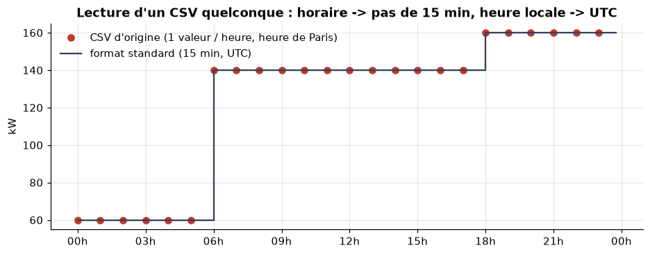

**Interprétation.** Le CSV horaire en heure de Paris devient bien 4 quarts d'heure par heure en
UTC (minuit à Paris = 23 h UTC en novembre). Le cœur du simulateur ne verra jamais que ce format.

### Prix spot 2025

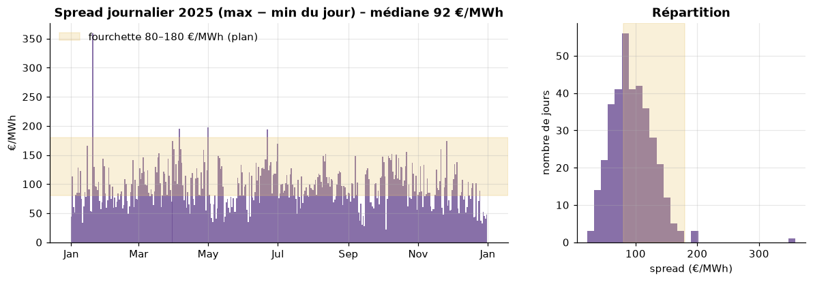

| Indicateur 2025 | Valeur |
|---|---|
| Spot moyen | **61,1 €/MWh** (min −118, max 473) |
| Heures à prix négatif / ≤ 0 | **509 h** / 742 h |
| Spread journalier (max − min) | médiane **92 €/MWh**, moyenne 95 |
| Jours avec un spread entre 80 et 180 €/MWh | **64 %** (35 % en dessous, 1 % au-dessus) |
| Spread médian hiver / été | 79 / 100 €/MWh |

**Interprétation.**
- La fourchette « 80 à 180 €/MWh » du plan (tâche 3) est **confirmée pour deux jours sur trois**,
  mais elle est plutôt basse que haute : la moitié des jours est sous 92 €/MWh et seul 1 % dépasse 180.
- Le profil horaire est en **« canard »** : prix bas, voire négatifs, en milieu de journée l'été (le
  solaire inonde le marché) et pics le matin et le soir. C'est exactement le creux que le PV
  subit et que la batterie peut exploiter.
- Le spread est plus grand **l'été** (100) que l'hiver (79) : il est porté par le solaire.

### Production PV : deux sources comparées

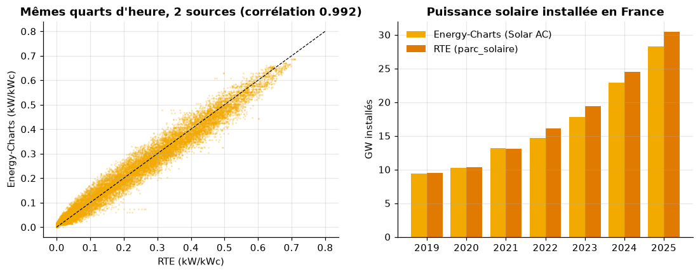

| Indicateur 2025 | Energy-Charts | RTE éCO2mix |
|---|---|---|
| Productible (kWh/kWc/an) | **1 069** | **1 068** |
| Puissance installée 2025 | 28,25 GW | 30,44 GW |
| Quarts d'heure manquants | 20 (dont 4 h le 10/12) | 2 |

**Interprétation.**
- Les deux sources donnent **le même productible annuel** (écart < 0,1 %) et une corrélation de
  0,99 au quart d'heure, alors que leurs puissances installées diffèrent de 7 %. Leurs
  périmètres sont donc cohérents entre eux. 1 069 kWh/kWc est proche des ~1 100 de la fiche prix : bon
  signe pour le modèle « facteur de charge national ».
- Limite : c'est un profil **national lissé** ; un site réel aura des journées plus « en dents de scie ».
- Les trous de données sont traités **explicitement** : interpolés s'ils durent ≤ 1 h, sinon le calcul
  s'arrête. Les scénarios 2025 autorisent 4 h (`max_gap_hours: 4`) pour le trou du 10/12 entre 16 h et 20 h, presque
  tout après le coucher du soleil.

---

## Étape 1 – Consommation bottom-up

| Test | Attendu | Obtenu |
|---|---|---|
| `test_frigo_parametres_du_plan` | ≈ 1 kWh/jour (plan) | **2,24 kWh/jour** ⚠️ voir ci-dessous |
| `test_frigo_aleatoire_mais_energie_constante` | aléa sur l'heure des cycles, énergie identique | ✅ |
| `test_appareils_a_horaire_fixe` | TV 0,5 kWh, éclairage 1,6 kWh | ✅ |
| `test_marche_quotidienne` | lave-linge 4 kWh/jour, dans sa plage horaire | ✅ |
| `test_chauffage_degres_jours` | k = 2, T = 5 °C → 30 kWh ; T ≥ 15 °C → 0 | ✅ |
| `test_changement_d_heure` | journée de 25 h correctement comptée | ✅ |
| `test_studio_environ_10_kwh_par_jour` | ≈ 10 kWh/jour | **10,34 kWh/jour** ✅ |
| `test_jours_ouvres` | appareil actif du lundi au vendredi seulement | ✅ |

**Interprétation – incohérence à trancher.** 400 W × (2 × 7 min) par heure × 24 h =
0,4 × 14/60 × 24 = **2,24 kWh/jour**, pas 1. Soit la conso visée (≈ 1 kWh/jour, plus réaliste pour
un frigo récent) est la bonne et il faut ~3 min de marche par cycle, ou 200 W ; soit les
paramètres sont bons et la conso est de 2,24. **J'ai gardé les paramètres du plan** en attendant ta décision.

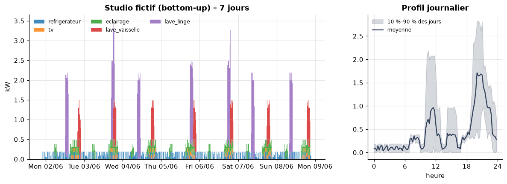
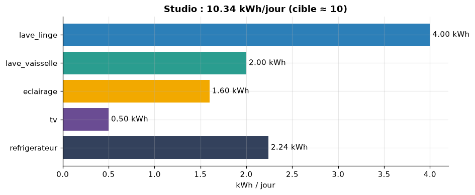

**Interprétation.** Le studio atteint 10,34 kWh/jour, mais c'est en partie **par construction** :
j'ai supposé un lave-linge et un lave-vaisselle tous les jours (6 kWh à eux deux, soit 58 % du
total). Avec un frigo à 1 kWh et des machines 3 fois par semaine, on tomberait vers 6–7 kWh/jour.
La courbe est très « en marches d'escalier » : c'est la limite du bottom-up simple (pas d'aléa
sur les puissances, pas de foisonnement).

**Interprétation.** Pour tester batterie et PV sur un client où ils ont du sens, j'ai **inventé**
une PME de bureaux : talon 15 kW (serveurs, froid), 45 kW de 8 h à 19 h en semaine, cantine 30 kW
à midi, recharge de véhicules 22 kW pendant 2 h à une heure aléatoire. Total : **288 MWh/an, pointe
112 kW**. Ce profil est à remplacer par une vraie courbe dès qu'on en aura une.

---

## Étape 2 – Coût sans équipement

| Test | Attendu | Obtenu |
|---|---|---|
| `test_bloc_spot_exemple_270_eur` | bloc 192 € + spot 78 € = **270 €** ; 90 €/MWh | ✅ (revente nuit −9,6 €, achat 87,6 €) |
| `test_comparaison_spot_pur_et_prix_fixe` | 276 € / 240 € | ✅ |
| `test_revente_au_spot_quand_puissance_negative` | la revente diminue le coût | ✅ |
| `test_prix_manquant_refuse` | refus de calculer s'il manque un prix | ✅ |
| `test_scenario_exemple_bloc_spot_via_csv`, `test_cli` | même résultat via YAML + CSV + ligne de commande | ✅ |

*(Ligne violette : prix spot, axe de droite.)*

**Interprétation.** Le cas de référence de la fiche est retrouvé **exactement**, par les trois
chemins (fonction, scénario, ligne de commande).

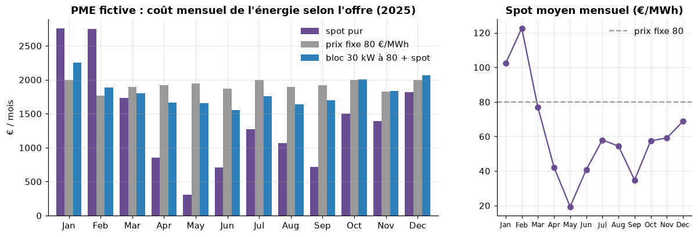

| PME, 2025 | Coût annuel de l'énergie |
|---|---|
| Spot pur | **16 860 €** (58,6 €/MWh pondéré par la conso) |
| Bloc 30 kW à 80 €/MWh + spot | 21 834 € |
| Prix fixe 80 €/MWh | 23 019 € |

**Interprétation.**
- En 2025, le spot (61 €/MWh en moyenne) est **sous** le prix fixe de 80 €/MWh que j'ai pris pour
  le bloc : le bloc coûte donc plus cher que le spot pur. C'est l'assurance que l'on paie pour un
  budget sécurisé. Le prix de 80 €/MWh est une hypothèse de la fiche, pas un vrai prix de marché à terme.
- Point utile pour la suite : **le gain d'un équipement est identique en spot pur et en bloc + spot**.
  Le bloc ajoute un terme constant (bloc × (prix bloc − spot)) qui ne dépend pas de la conso. La
  batterie et le PV agissent seulement sur la part au spot.
- Les mois d'été coûtent moins, à cause d'un spot bas en mai–juin.

---

## Étape 3 – PV seul

| Test | Attendu | Obtenu |
|---|---|---|
| `test_conversion_rayonnement_exemples_du_plan` | 1000 J/cm² → 0,14 ; 1700 → 0,24 kW/m² | **0,139 / 0,236** ✅ |
| `test_pv_depuis_facteur_de_charge_et_rayonnement` | P = cf × kWc ; plafond 250 W/m² | ✅ |
| `test_pv_seul_autoconsommation_et_surplus` | 4 kWh autoconsommés, 8 revendus, 20 achetés | ✅ |
| `test_revente_au_prix_de_rachat` | surplus payé 1,1 c€/kWh | ✅ |
| `test_surcout_sur_les_kwh_achetes` | surcoût appliqué aux seuls kWh achetés | ✅ |

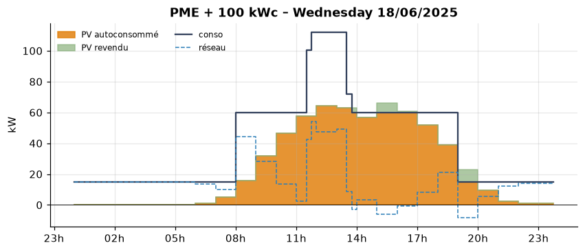

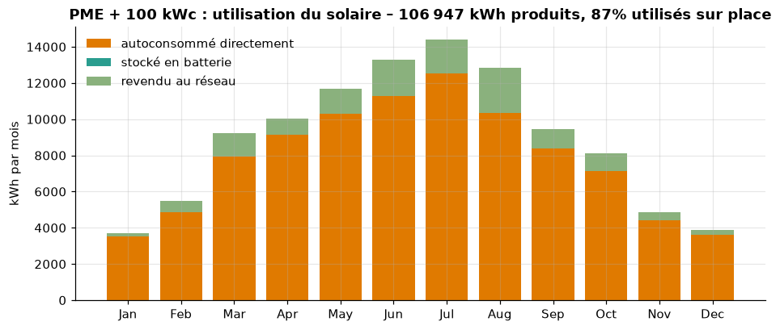

| PME + 100 kWc (2025) | Valeur |
|---|---|
| Production | 106 947 kWh |
| Autoconsommation (part du PV utilisée sur place) | **87 %** |
| Autoproduction (part de la conso couverte par le PV) | **32 %** |
| Valeur moyenne d'un kWh PV autoconsommé / revendu | **39 €/MWh / 14 €/MWh** (spot moyen 61) |

**Interprétation.**
- En semaine, le PV est presque entièrement absorbé par les bureaux ; **le surplus apparaît le
  week-end** (samedi : quasiment tout est revendu).
- **Effet de cannibalisation :** un kWh solaire vaut en moyenne 39 €/MWh au spot, contre 61 pour un
  kWh moyen, parce que le solaire produit aux heures où le prix est bas. Le surplus revendu ne vaut
  que 14 €/MWh, car il tombe surtout les week-ends ensoleillés à prix négatif ou nul.

**Interprétation.** Au-delà de ~50 kWc, l'autoconsommation baisse : le PV dépasse la conso le midi.
Si le surplus est revendu au spot, le gain est **strictement proportionnel** aux kWc, car un kWh
autoconsommé et un kWh revendu valent alors la même chose. Si le surplus n'est pas payé, la
courbe rouge s'aplatit : 400 kWc rapportent 9 000 € au lieu de 15 400 €. **Le contrat de
revente (et le TURPE évité) décide du bon dimensionnement.**

---

## Étape 4 – Batterie « règle simple » (stocker le surplus PV)

| Test | Attendu | Obtenu |
|---|---|---|
| `test_batterie_un_pas` | E += η·P·Δt ; P bornée à 0,5 C ; pas de décharge sous SOC min | ✅ |
| `test_batterie_surplus_pv_rendement_aller_retour` | 8 kWh chargés → 7,2 kWh restitués (90 %) | ✅ |
| `test_batterie_pleine_le_surplus_est_revendu` | SOC plafonné à 90 %, le reste est revendu | ✅ |
| `check_balance` (appelé à chaque simulation) | bilan P_grid, SOC dans les bornes, énergie conservée | ✅ sur toutes les simulations annuelles |

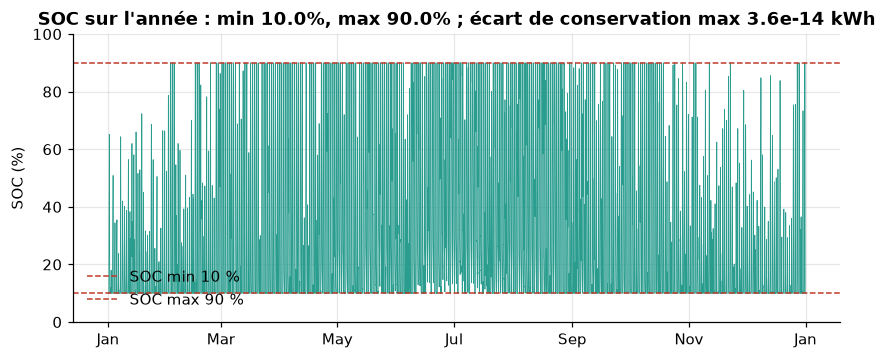

| Studio, 3 kWc (2025) | Sans batterie | Avec 5 kWh |
|---|---|---|
| Autoconsommation | 33 % | **77 %** |
| Autoproduction | 28 % | **62 %** |
| Achat réseau | 2 728 kWh | 1 449 kWh |
| Cycles / an ; pertes | – | 337 ; 142 kWh |
| Coût énergie (spot, surplus à 1,1 c€) | 191 € | 109 € |

**Interprétation.**
- Le modèle de batterie est **physiquement cohérent** : SOC toujours entre 10 et 90 %, énergie
  conservée à 4·10⁻¹⁴ kWh près sur l'année, pertes de 10 % retrouvées.
- L'été, la batterie se remplit chaque jour et se vide le soir : c'est le cas d'usage idéal.
  L'hiver, elle se remplit à peine : le PV couvre déjà difficilement la conso.
- La batterie **double l'autoconsommation** du studio. En euros, elle ne fait pourtant gagner que
  **83 €/an**, car on ne compte que le prix de l'énergie (~70 €/MWh en moyenne pour le studio).

---

## Étape 5 – Batterie « prix » (prix du lendemain connus)

| Test | Attendu | Obtenu |
|---|---|---|
| `test_strategie_prix_gagne_les_jours_a_fort_spread` | gain 1,349 € > règle simple (0 €) | ✅ |
| `test_strategie_prix_ne_charge_pas_sans_spread` | pas d'achat pour stocker si le spread ne couvre pas les pertes | ✅ |
| `test_strategie_prix_vide_la_batterie_meme_si_la_conso_est_faible` | décharge complète même à 1 kW de conso | ✅ |
| `test_strategie_prix_respecte_la_limite_reseau` | la charge ne dépasse pas la puissance souscrite | ✅ |

**Règle utilisée :** chaque jour, on charge depuis le réseau sur les quarts d'heure les moins chers
et on décharge sur les plus chers, en choisissant juste assez de quarts d'heure pour remplir puis
vider la batterie. On le fait seulement si le spread du jour couvre les pertes. Le surplus PV est toujours stocké.

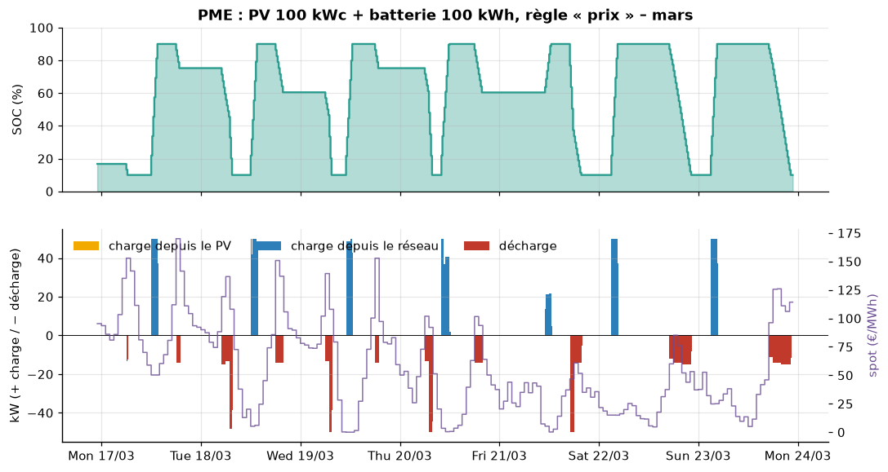
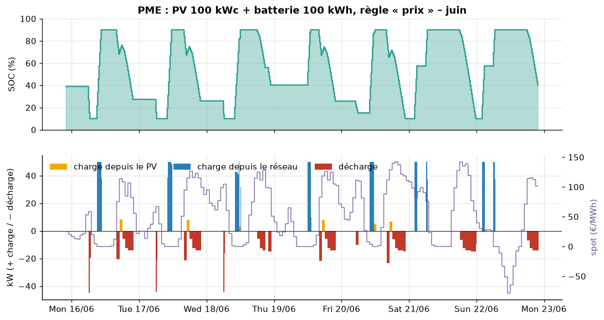

**Interprétation.** La batterie fait environ un cycle par jour : elle se charge **la nuit** ou **au
creux de midi** (prix bas ou négatifs) et se décharge **le matin et le soir**. En juin, la
charge de midi coïncide avec le creux solaire : stocker l'énergie solaire, c'est aussi acheter le kWh le moins cher de la journée.

| PME, économie annuelle vs « rien » | Énergie | Pénalités | Total | Cycles/an |
|---|---|---|---|---|
| PV 100 kWc seul | 3 841 € | 2 179 € | 6 020 € | – |
| PV + batterie, surplus PV | 4 185 € | 2 179 € | 6 364 € | 84 |
| **PV + batterie, prix** | **5 479 €** | 2 179 € | **7 658 €** | 339 |
| PV + batterie, prix **sans limite de puissance** | 5 473 € | **−1 308 €** | 4 165 € | 338 |
| Batterie seule, prix | 1 828 € | 0 € | 1 828 € | 345 |
| Batterie seule, surplus PV | 0 € | 0 € | 0 € | 0 |
| **Batterie seule, peak shaving** | 6 € | **2 640 €** | 2 646 € | 39 |
| PV + batterie, peak shaving | 3 839 € | 2 640 € | 6 479 € | 1 |

**Interprétation.**
- **Validation de l'étape :** sur les jours à fort spread (quart supérieur), la règle « prix »
  rapporte **7,40 €/jour** contre 0 € pour la règle simple (batterie seule) ; le gain croît
  nettement avec le spread. ✅
- Sur une PME qui autoconsomme déjà 87 % de son PV, la règle « surplus PV » n'apporte presque
  rien (+344 €) : il n'y a pas de surplus à stocker en semaine. **C'est l'arbitrage de prix qui fait travailler la batterie.**
- ⚠️ **Découverte :** si on laisse la batterie se charger depuis le réseau sans limite, la pointe passe de 112
  à **136 kW** et les pénalités augmentent (−1 308 €). Il faut toujours brider la charge par la
  puissance souscrite. C'est maintenant le comportement par défaut dès qu'un scénario déclare une puissance souscrite.
- 5 % des jours, la règle perd un peu d'argent : elle ne regarde que les seuils de prix, pas
  **l'ordre** des heures (elle peut décharger le matin à un prix « haut » puis manquer d'énergie pour un soir encore plus cher).
  Une optimisation (étape 9) ferait mieux.
- Première version de la règle (corrigée pendant les tests) : elle visait les 7 quarts d'heure les plus chers en
  supposant une décharge à 50 kW, alors que la PME ne consomme que ~15 kW le soir. La batterie ne
  se vidait jamais. La correction a fait passer le gain de 1 207 à **1 828 €/an** (+51 %).

---

## Étape 6 – Peak shaving

| Test | Attendu | Obtenu |
|---|---|---|
| `test_peak_shaving_ecrete_les_pointes` | pointe 30 → 20 kW ; recharge sous 18 kW ; pénalité 100 € → 0 € | ✅ |

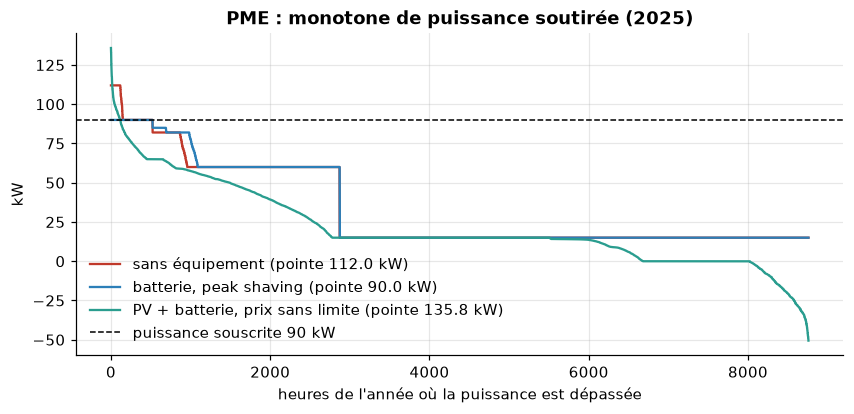

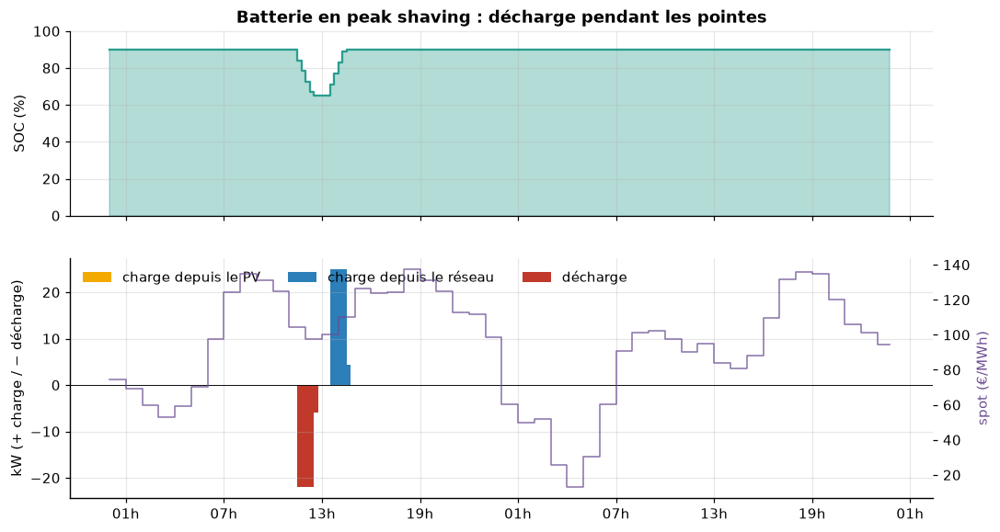

**Interprétation.**
- La pointe annuelle passe de **112 à 90 kW**, exactement la puissance souscrite, et la pénalité de
  2 640 € à **0 €**. La batterie ne fait que 39 cycles par an : elle s'use très peu.
- La monotone montre que la PME ne dépasse 90 kW que **~500 h/an** (cantine + recharge des véhicules) :
  des pointes courtes, idéales pour une batterie.
- ⚠️ **La pénalité de 10 €/kW/mois est inventée** et la règle de calcul (dépassement maximal du mois) est
  simplifiée. Comme le gain du peak shaving en dépend entièrement, il faut une vraie grille tarifaire avant de conclure.

---

## Étape 7 – Rentabilité

| Test | Attendu | Obtenu |
|---|---|---|
| `test_capex_et_cout_usure` | fiche 5 : 100 kWh, 40 000 €, 5 000 cycles, 80 % → 0,10 €/kWh | ✅ |
| `test_temps_de_retour` | CAPEX 9 500 €, gain 950 €/an → 10 ans ; vie plafonnée à 15 ans | ✅ |

**Hypothèses :** prix unitaires de la fiche 2 (bas / médian / haut), durée de vie de la batterie = min(5 000
cycles, 15 ans), PV 25 ans, OPEX du PV 1,5 %/an, sans actualisation ni dégradation, année 2025 répétée.

| Cas (2025, énergie au spot) | Retour prix bas / médian / haut | Durée de vie | Rentable ? |
|---|---|---|---|
| PME : PV 100 kWc | 12 / 28 / 54 ans | 25 ans | **seulement au prix bas** |
| PME : batterie 100 kWh seule, arbitrage | 16 / 23 / 30 ans | 14,5 ans | **non** |
| PME : batterie 100 kWh seule, peak shaving | 11 / 16 / 21 ans | 15 ans | **limite** (bas : oui) |
| PME : batterie ajoutée au PV, arbitrage | 18 / 26 / 34 ans | 14,7 ans | non |
| Studio : PV 3 kWc | jamais (médian) | 25 ans | non (au spot) |
| Studio : batterie 5 kWh ajoutée | 36 / 58 / 79 ans | 14,8 ans | non (au spot) |

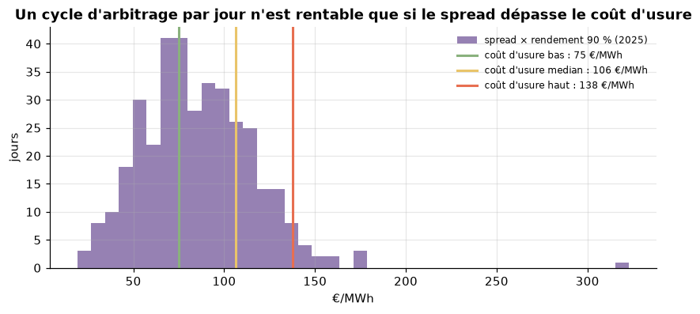

**Interprétation.**
- **Arbitrage seul : non rentable en 2025.** Le coût d'usure d'un kWh déchargé (CAPEX ÷ kWh
  restituables sur la vie) vaut **106 €/MWh** au prix médian, alors que le spread journalier × 90 % ne le
  dépasse que **24 % des jours**. Quelle que soit la taille, le gain annuel reste sous le coût annualisé.
- Au-delà de 200 kWh, le gain **baisse** (400 kWh rapportent moins que 200 kWh) : la règle charge
  sur trop de quarts d'heure pas assez bon marché, sous la contrainte de puissance souscrite. Une
  batterie plus grande ne peut pas faire moins bien avec un pilotage optimal : c'est une **limite de la règle simple**.
- **Ce qui peut rendre la batterie rentable : les pénalités de puissance**, avec peu de cycles et un fort
  gain par kWh, mais elles reposent ici sur une hypothèse inventée.

**Interprétation de la sensibilité** (surcoût ajouté à chaque kWh acheté : acheminement + taxes) :
- **PV de la PME :** dès 50 €/MWh de surcoût évité, le retour tombe à 18 ans ; à 100 €/MWh, à **10,5 ans**. Le PV
  devient clairement rentable : ce sont ces coûts évités qui font sa valeur, plus que le spot.
- **Batterie du studio, ajoutée au PV :** à 200 €/MWh (ordre de grandeur d'un particulier, à vérifier), retour d'environ **14 ans**,
  soit à peu près sa durée de vie. C'est à la limite.
- **Batterie seule en arbitrage :** son gain **diminue** quand le surcoût augmente. Elle achète
  plus de kWh au réseau qu'elle n'en restitue (pertes de 10 %), et chaque kWh acheté supporte le surcoût. L'arbitrage pur
  est pénalisé par les tarifs de réseau.

---

## Étape 8 – Les 7 graphiques du plan (commande `python -m simu run … --out`)

Générés automatiquement pour la PME (PV 100 kWc + batterie 100 kWh, règle prix) ; même jeu pour le
studio dans [fig/e8_studio](fig/e8_studio). Export CSV de tous les pas : `results/pme/resultats.csv`.

| # | Graphique | PME |
|---|---|---|
| 1 | Utilisation du solaire | 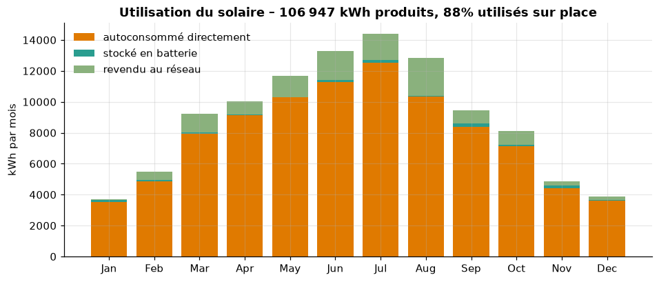 |
| 2 | Utilisation de la batterie |  |
| 3 | Courbe de charge brute |  |
| 4 | Ce qu'on achète au réseau |  |
| 5 | Coût de l'énergie |  |
| 6 | Coût de la batterie |  |
| 7 | Coût des panneaux |  |

**Interprétation.** L'économie mensuelle est assez régulière en euros (≈ 300 à 700 €/mois). L'hiver,
c'est surtout la batterie qui arbitre des prix élevés ; l'été, c'est le PV. En proportion, elle est
bien plus forte l'été (juillet : −55 %) que l'hiver (janvier : −20 %). Les graphiques 6 et 7 séparent bien les deux investissements. La batterie,
évaluée **en plus** du PV, ne rentre pas dans ses frais sur 15 ans, même au prix bas.
Le PV (gain de 6 020 €/an, pénalités évitées comprises) n'est rentable qu'au prix bas (retour
en 12 ans) ; au prix médian il finit à −14 500 € au bout de 25 ans (toujours sans acheminement ni taxes évités).

---

## Limites connues (à garder en tête en lisant les chiffres)

1. **Clients inventés** (studio, PME) et **pénalité de dépassement inventée** (10 €/kW/mois).
2. **Pas d'acheminement ni de taxes** dans le coût par défaut : gains de l'autoconsommation sous-estimés (§ 7).
3. Une seule année (2025), répétée sur toute la durée de vie : pas d'actualisation, pas d'inflation, pas de dégradation.
4. Profil PV **national** (lissé) ; pas encore de variante par site (Open-Meteo, PVGIS…).
5. Règles de pilotage simples, non optimales (chronologie des prix ignorée ; batterie > 200 kWh mal exploitée).
6. Coût unitaire pris dans la classe de taille la plus proche (10 / 100 / 1000) : marches d'escalier entre les tailles.
7. Écart de prix du PV : le médian de la fiche pour 100 kWc (120 k€) est au-dessus du « coût moyen 80–100 k€ en toiture simple » cité dans la même fiche.

## Décisions et informations attendues

- **Frigo :** 1 kWh/jour ou paramètres 400 W / 7 min / 2×/h (= 2,24 kWh) ?
- **Composition du studio** et fréquence des machines.
- **Grille de pénalités de dépassement** réelle (TURPE / contrat) et puissance souscrite type.
- **Surcoût par kWh acheté** (acheminement + taxes) à retenir par type de client.
- **Prix de revente** du surplus pour un client pro (spot via agrégateur ? obligation d'achat ?).
- Valider l'ajout de `import_surcharge_eur_mwh`, `export_price_eur_mwh`, `grid` et `strategy` au format YAML.
