# Rapport de tests – Simulateur énergie (étapes 0 à 8 + simulation Strasbourg)

*24/11/2026 – branche `etapes-0-2`. Données réelles : prix spot et production PV France 2025
(Energy-Charts, RTE éCO2mix). Clients **fictifs** : un studio et une PME de bureaux (bottom-up).*

Régénérer les graphiques et les chiffres : `python scripts/rapport.py` (≈ 25 s, données en cache).
Chiffres bruts : [chiffres.json](chiffres.json).

---

## En bref

| Question | Réponse sur 2025 (clients fictifs) |
|---|---|
| Les tests passent-ils ? | **49 / 49** (dont 3 qui interrogent les vraies API) |
| Le spread 80–180 €/MWh du plan est-il confirmé ? | **Oui en grande partie** : médiane 92 €/MWh, 64 % des jours entre 80 et 180 ; mais 35 % des jours sont **sous** 80 |
| Une batterie est-elle rentable **sur l'énergie seule (spot)** ? | **Non** dans nos cas : temps de retour 16 à 30 ans pour une durée de vie d'environ 15 ans |
| Qu'est-ce qui peut la rendre rentable ? | **Les pénalités de dépassement** (peak shaving) et **les coûts évités sur chaque kWh acheté** (acheminement + taxes, non modélisés par défaut). Ce sont eux qui décident, pas le spread |
| La simulation du PowerPoint (Strasbourg, météo réelle) ? | **Faite** : PV d'après le rayonnement réel du Grand Est (1 076 kWh/kWc modélisés contre 1 068 mesurés par RTE), chauffage d'après la température réelle. Mêmes conclusions de rentabilité (voir § Strasbourg) |
| Le PV est-il rentable ? | Pour la PME : oui avec un prix d'achat bas (12 ans) ; non au prix médian (28 ans) si on ne compte que le spot. Rentable dès qu'on compte ~50 €/MWh de coûts évités (retour 18 ans), nettement à 100 €/MWh (10,5 ans) |

⚠️ **Lecture importante :** le coût d'achat simulé est **uniquement le prix de l'énergie** (spot,
fixe ou bloc + spot), comme dans la fiche bloc + spot. Une vraie facture contient aussi
l'**acheminement (TURPE)** et des **taxes**, payés sur chaque kWh soutiré et donc évités par
l'autoconsommation. Sans eux, les gains du PV et de la batterie sont **sous-estimés**. J'ai
ajouté un paramètre (`import_surcharge_eur_mwh`, 0 par défaut) et une analyse de sensibilité
(§ 7), mais **je n'ai pas fixé de valeur** : elle dépend du contrat du client.

---

## Petit lexique (pour lire les graphiques)

| Terme | Signification |
|---|---|
| **kW / kWh** | puissance (à un instant) / énergie (puissance × durée). 1 kW pendant 1 h = 1 kWh |
| **€/MWh** | prix de l'électricité ; 100 €/MWh = 0,10 €/kWh |
| **Spot** | prix du marché de gros, différent pour chaque quart d'heure, connu la veille |
| **Spread** | écart entre le prix le plus haut et le plus bas d'une journée |
| **kWc** | « kilowatt-crête » : puissance maximale d'une installation de panneaux |
| **SOC** | niveau de charge de la batterie, en % (gardé ici entre 10 et 90 %) |
| **Autoconsommation** | part de la production solaire consommée sur place |
| **Autoproduction** | part de la consommation couverte par le solaire |
| **Puissance souscrite** | puissance maximale prévue au contrat ; la dépasser coûte une pénalité |
| **Peak shaving** | utiliser la batterie pour « raboter » les pics de consommation |
| **Bloc + spot** | contrat où une partie de l'énergie est achetée d'avance à prix fixe, le reste au prix du marché |

---

## Étape 0 – Données et format standard

### Tests

| Test | Ce qu'il vérifie | Résultat |
|---|---|---|
| `test_csv_quelconque_avec_mapping_yaml` | CSV « à la française » (`;`, virgule décimale, heure de Paris, W) → format standard | ✅ |
| `test_horodatage_en_fin_de_pas_et_plusieurs_colonnes` | horodatage en fin de pas (type Linky), 2 colonnes | ✅ |
| `test_mapping_invalide` | messages d'erreur clairs si le mapping est faux | ✅ |
| `test_horaire_vers_15min_…`, `test_5min_…`, `test_pas_mixte_…`, `test_trou_reste_vide` | conversion de pas, énergie conservée, trous non bouchés en silence | ✅ |
| `test_energy_charts_prix_horaire_puis_15min` | prix réels du 30/09/2025 (horaire) et du 01/10/2025 (15 min) | ✅ |
| `test_energy_charts_facteur_de_charge_pv`, `test_rte_…` | facteur de charge PV = production ÷ puissance installée | ✅ |
| `test_cache_http`, `test_retries_puis_erreur`, `test_limite_de_debit_429_puis_succes` | cache, nouvelles tentatives, respect de la limite de débit | ✅ |
| `test_reseau_energy_charts_prix_et_pv`, `test_reseau_rte_pv` | appel réel aux API | ✅ |

> 📊 **Comment lire :** Une journée de consommation fictive lue depuis un fichier CSV. Les points rouges sont les valeurs du fichier (une par heure) ; la ligne bleu foncé est ce que le simulateur en fait (une valeur tous les quarts d'heure). Les deux se superposent : la conversion ne déforme pas les données.

**Interprétation.** Le CSV horaire en heure de Paris devient bien 4 quarts d'heure par heure en
UTC (minuit à Paris = 23 h UTC en novembre). Le cœur du simulateur ne verra jamais que ce format.

### Prix spot 2025

> 📊 **Comment lire :** Prix de l'électricité sur le marché de gros français en 2025 (« spot », en € par MWh). À gauche, chaque jour : la bande violette va du prix le plus bas au plus haut du jour, la ligne donne la moyenne. À droite, le prix moyen à chaque heure de la journée, en hiver (bleu) et en été (jaune) : l'été, le prix s'effondre en milieu de journée à cause du solaire.

> 📊 **Comment lire :** Le « spread » est l'écart entre le prix le plus haut et le plus bas d'une même journée : c'est ce qu'une batterie peut gagner en achetant au creux et en revendant au pic. À gauche, une barre par jour de 2025 ; à droite, combien de jours tombent dans chaque tranche d'écart. La bande jaune est la fourchette 80–180 €/MWh annoncée dans le plan.

| Indicateur 2025 | Valeur |
|---|---|
| Spot moyen | **61,1 €/MWh** (min −118, max 473) |
| Heures à prix négatif (< 0) sur l'année | **509 h**, réparties sur 97 jours (détail plus bas) |
| Heures à prix exactement nul (= 0) | **233 h** (soit 742 h à prix ≤ 0) |
| Spread journalier (max − min) | médiane **92 €/MWh**, moyenne 95 |
| Jours avec un spread entre 80 et 180 €/MWh | **64 %** (35 % en dessous, 1 % au-dessus) |
| Spread médian hiver / été | 79 / 100 €/MWh |

**Interprétation.**
- La fourchette « 80 à 180 €/MWh » du plan (tâche 3) est **confirmée pour deux jours sur trois**,
  mais elle est plutôt basse que haute : la moitié des jours est sous 92 €/MWh et seul 1 % dépasse 180.
- Le profil horaire est en **« canard »** : prix bas, voire négatifs, en milieu de journée l'été (le
  solaire inonde le marché) et pics le matin et le soir. C'est exactement le creux que le PV
  subit et que la batterie peut exploiter.
- Le spread est plus grand **l'été** (100) que l'hiver (79) : il est porté par le solaire.

### Zoom : le jour record du lundi 20 janvier 2025 (spread de 359 €/MWh)

Ce sont bien des **données réelles** : les prix day-ahead (fixés la veille) de la zone de prix France,
récupérés par l'API Energy-Charts (source citée par l'API : Bundesnetzagentur | SMARD.de). Le pic visible en janvier sur le graphique du spread est
**un seul jour**, le lundi 20/01/2025 : de **114 €/MWh à 3 h** à **473 €/MWh de 18 h à 19 h**.
Les 5 jours suivants du classement ont tous un spread inférieur à 200 €/MWh. Trois d'entre eux sont des
jours à prix très négatifs (1er mai, 6 avril, 22 juin : jusqu'à −118 €/MWh), pas des jours à prix très hauts.

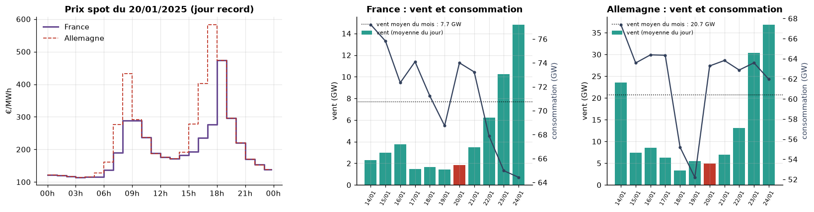

> 📊 **Comment lire :** À gauche, le prix heure par heure le 20/01/2025, en France (violet) et en
> Allemagne (pointillés rouges). Au centre et à droite, pour chaque jour autour du 20/01 : la
> production des éoliennes (barres, la rouge = le 20/01) et la consommation (ligne, axe de droite),
> en France puis en Allemagne. Le 20/01, il n'y a presque pas de vent alors que la consommation est forte.

| 20/01/2025 | Ce jour-là | Moyenne de janvier |
|---|---|---|
| Vent en France | **1,8 GW** | 7,7 GW |
| Vent en Allemagne | **4,9 GW** | 20,7 GW |
| Consommation France | **74 GW** | 66 GW |
| Consommation Allemagne | 63 GW | 59 GW |
| Centrales à gaz en France | **7,4 GW** | 4,0 GW |
| Prix France / Allemagne à 18 h | **473 / 473 €/MWh** | – |

**Pourquoi ce pic ?** Ce que les données montrent :
1. **Froid, pas de vent et nuit tombée :** un lundi d'hiver, avec une consommation élevée en France et en Allemagne, et
   des éoliennes presque à l'arrêt **des deux côtés du Rhin** (4 fois moins de vent que d'habitude en
   Allemagne). À 18 h, le solaire est à zéro. Les Allemands appellent ce type de situation
   *Dunkelflaute* (« calme sombre »).
2. **Le prix européen tire le prix français :** les marchés européens sont couplés. À 18 h, la
   France et l'Allemagne ont **exactement le même prix (473,28 €)**, alors que la France est
   **exportatrice** (5,4 GW d'exports en moyenne ce jour-là). Quand les lignes d'interconnexion sont saturées, les prix
   se séparent : à 17 h, 583 € en Allemagne contre 276 € en France.
3. **Les centrales les plus chères fixent le prix :** sur ce marché, le prix de l'heure est celui de la
   dernière centrale appelée pour satisfaire la demande. Pour passer la pointe de 18 h, il faut appeler des
   centrales coûteuses : le gaz produit presque deux fois plus que d'habitude en France ce jour-là.

*Limite :* les données confirment le vent, la consommation, le gaz et le couplage des prix. Je n'ai pas
vérifié les autres causes possibles (indisponibilités de centrales, prix du gaz ce jour-là).

**Pour le projet :** un tel jour est idéal pour une batterie (acheter à 114 €, revendre à 473 €), mais
il est **unique dans l'année**. On ne peut pas bâtir une rentabilité sur ce genre d'événement.

### Zoom : les heures à prix négatif ou nul

**Comment est compté « 509 h » :** les prix sont publiés par quart d'heure (par heure avant octobre 2025). J'additionne
tous les quarts d'heure de 2025 où le prix est **strictement négatif**, puis je convertis en heures
(4 quarts d'heure = 1 h). Ces 509 h ne sont **pas consécutives** : elles sont réparties sur **97 jours
différents**. S'y ajoutent **233 h à prix exactement nul**.

> 📊 **Comment lire :** Les heures à prix négatif de 2025, découpées de quatre façons. En haut à gauche,
> par mois (bleu : prix négatif ; gris : prix exactement nul). En haut à droite, par heure de la journée.
> En bas à gauche, par niveau de prix : la grande majorité est juste sous zéro. En bas à droite, par jour
> de la semaine (rouge : week-end).

| Question | Réponse (2025) |
|---|---|
| **Quels mois ?** | **avril à juin** (353 h sur 509) puis août–septembre (123 h) ; **aucune** de novembre à février |
| **Quelles heures ?** | **87 %** entre 10 h et 17 h, pic vers 14 h ; seulement 36 h la nuit |
| **Quels jours ?** | **49 %** le samedi ou le dimanche (alors que le week-end ne représente que 28 % des jours) ; le prix le plus bas est tombé un **jour férié** (jeudi 1er mai, −118 €/MWh) |
| **Quel niveau ?** | **très faible la plupart du temps** : prix médian −0,06 €/MWh ; 282 h entre −0,1 et 0 €/MWh ; seulement **108 h sous −5 €/MWh** et 17 h sous −50 €/MWh |
| **Jours les plus touchés** | 05/06 (16 h), 05/08 (14 h), 07/09 (13 h), 25/05 et 03/06 (10 h) |

**Pourquoi ?** Un prix négatif veut dire que des producteurs **paient pour continuer à produire**.
Cela arrive quand la production qu'on ne peut ou ne veut pas arrêter dépasse ce que le marché absorbe :
- **beaucoup de soleil** (milieu de journée, printemps–été) : le parc solaire français a gagné
  environ 5 GW en un an (voir § PV) ;
- **peu de consommation** : week-ends, jours fériés, pas de chauffage au printemps ;
- **des centrales qu'on ne peut pas ou ne veut pas arrêter** : le nucléaire et l'hydraulique au fil de l'eau
  ne peuvent pas baisser autant ni aussi vite que nécessaire ; selon leur contrat de soutien, certains
  producteurs renouvelables n'ont pas intérêt à s'arrêter *(mécanismes non vérifiés en détail ici)* ;
- **des voisins dans la même situation** (Allemagne, Espagne : beaucoup de solaire aussi), donc
  l'export ne suffit pas à écouler le surplus.

*Hypothèses non vérifiées dans les données :* les 282 h « à peine négatives » (entre −0,1 et 0) viennent
probablement d'offres placées juste sous zéro par certains producteurs ; le creux de juillet (7 h seulement)
n'est pas expliqué ici (consommation de climatisation ? moins de nucléaire disponible ?). Il faudrait regarder les données de production en détail.

**Pour le projet :** les prix négatifs tombent **exactement quand les panneaux produisent le plus**.
1. Le surplus solaire revendu au spot ne vaut presque rien à ces heures-là (14 €/MWh en moyenne pour la PME, § 3).
2. Une batterie peut s'y **charger gratuitement, voire en étant payée**, pour restituer le soir.
3. Mais en volume, ces heures restent rares (≈ 6 % de l'année) et souvent à peine négatives.

### Production PV : deux sources comparées

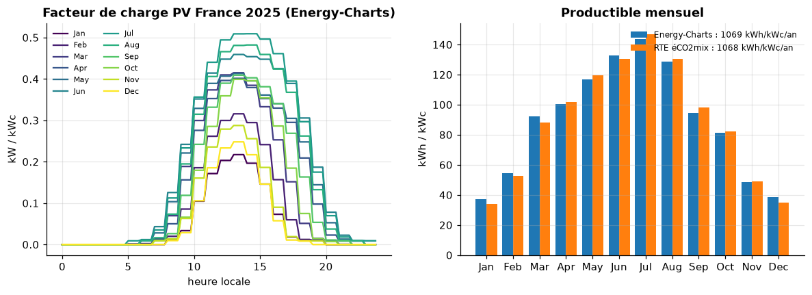

> 📊 **Comment lire :** À gauche, la production moyenne d'1 kWc de panneaux (kWc = puissance maximale) au cours d'une journée, mois par mois : 0,5 veut dire que le panneau produit la moitié de sa puissance maximale. À droite, l'énergie produite chaque mois par 1 kWc, selon deux sources de données (bleu et orange) : elles donnent presque la même chose.

> 📊 **Comment lire :** Comparaison des deux sources de données solaires. À gauche, chaque point est un quart d'heure de 2025 : s'il est sur la diagonale, les deux sources sont d'accord, ce qui est presque toujours le cas. À droite, la puissance solaire installée en France chaque année selon chaque source : elles diffèrent d'environ 7 %.

| Indicateur 2025 | Energy-Charts | RTE éCO2mix |
|---|---|---|
| Productible (kWh/kWc/an) | **1 069** | **1 068** |
| Puissance installée 2025 | 28,25 GW | 30,44 GW |
| Quarts d'heure manquants | 20 (dont 4 h le 10/12) | 2 |

**Interprétation.**
- Les deux sources donnent **le même productible annuel** (écart < 0,1 %) et une corrélation de
  0,99 au quart d'heure, alors que leurs puissances installées diffèrent de 7 %. Leurs
  périmètres sont donc cohérents entre eux. 1 069 kWh/kWc est proche des ~1 100 de la fiche prix : bon
  signe pour le modèle « facteur de charge national ».
- Limite : c'est un profil **national lissé** ; un site réel aura des journées plus « en dents de scie ».
- Les trous de données sont traités **explicitement** : interpolés s'ils durent ≤ 1 h, sinon le calcul
  s'arrête. Les scénarios 2025 autorisent 4 h (`max_gap_hours: 4`) pour le trou du 10/12 entre 16 h et 20 h, presque
  tout après le coucher du soleil.

---

## Étape 1 – Consommation bottom-up

| Test | Attendu | Obtenu |
|---|---|---|
| `test_frigo_parametres_du_plan` | ≈ 1 kWh/jour (plan) | **2,24 kWh/jour** ⚠️ voir ci-dessous |
| `test_frigo_aleatoire_mais_energie_constante` | aléa sur l'heure des cycles, énergie identique | ✅ |
| `test_appareils_a_horaire_fixe` | TV 0,5 kWh, éclairage 1,6 kWh | ✅ |
| `test_marche_quotidienne` | lave-linge 4 kWh/jour, dans sa plage horaire | ✅ |
| `test_chauffage_degres_jours` | k = 2, T = 5 °C → 30 kWh ; T ≥ 15 °C → 0 | ✅ |
| `test_changement_d_heure` | journée de 25 h correctement comptée | ✅ |
| `test_studio_environ_10_kwh_par_jour` | ≈ 10 kWh/jour | **10,34 kWh/jour** ✅ |
| `test_jours_ouvres` | appareil actif du lundi au vendredi seulement | ✅ |

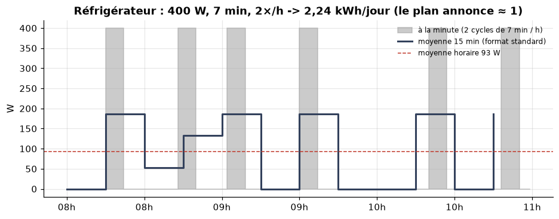

> 📊 **Comment lire :** Consommation simulée d'un réfrigérateur pendant 3 heures. En gris, son fonctionnement minute par minute (400 W pendant 7 min, 2 fois par heure) ; en bleu foncé, la moyenne par quart d'heure utilisée par le simulateur. La moyenne (93 W en continu) donne 2,24 kWh par jour, et non les 1 kWh annoncés dans le plan.

**Interprétation – incohérence à trancher.** 400 W × (2 × 7 min) par heure × 24 h =
0,4 × 14/60 × 24 = **2,24 kWh/jour**, pas 1. Soit la conso visée (≈ 1 kWh/jour, plus réaliste pour
un frigo récent) est la bonne et il faut ~3 min de marche par cycle, ou 200 W ; soit les
paramètres sont bons et la conso est de 2,24. **J'ai gardé les paramètres du plan** en attendant ta décision.

> 📊 **Comment lire :** Consommation simulée d'un studio pendant une semaine, appareil par appareil (une couleur par appareil, empilées). À droite, la journée « moyenne » : la ligne est la moyenne, la bande grise contient 80 % des jours. Les pics du soir viennent du lave-vaisselle, ceux de la journée du lave-linge.

> 📊 **Comment lire :** Énergie consommée par jour par chaque appareil du studio. Le total, 10,34 kWh/jour, correspond aux ≈ 10 kWh attendus. Le lave-linge et le lave-vaisselle pèsent plus de la moitié, parce que j'ai supposé qu'ils tournent tous les jours.

**Interprétation.** Le studio atteint 10,34 kWh/jour, mais c'est en partie **par construction** :
j'ai supposé un lave-linge et un lave-vaisselle tous les jours (6 kWh à eux deux, soit 58 % du
total). Avec un frigo à 1 kWh et des machines 3 fois par semaine, on tomberait vers 6–7 kWh/jour.
La courbe est très « en marches d'escalier » : c'est la limite du bottom-up simple (pas d'aléa
sur les puissances, pas de foisonnement).

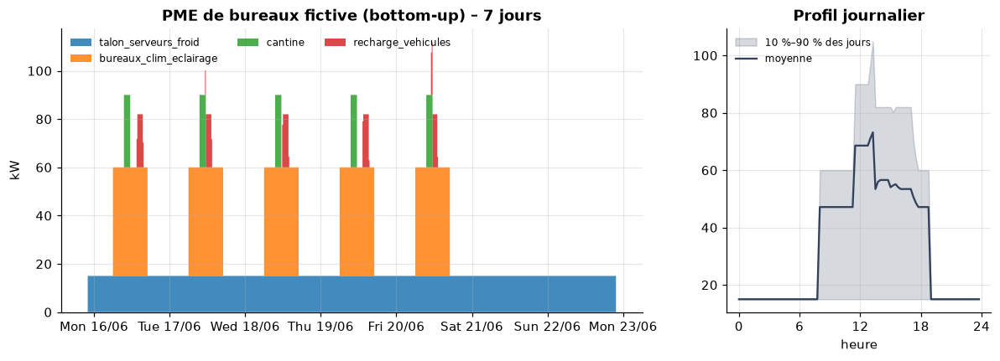

> 📊 **Comment lire :** Consommation simulée d'une PME de bureaux inventée pendant une semaine de juin (une couleur par usage). On voit le socle permanent (serveurs, froid), la journée de bureau en semaine, le pic de la cantine à midi et la recharge des véhicules. Le week-end, il ne reste que le socle.

**Interprétation.** Pour tester batterie et PV sur un client où ils ont du sens, j'ai **inventé**
une PME de bureaux : talon 15 kW (serveurs, froid), 45 kW de 8 h à 19 h en semaine, cantine 30 kW
à midi, recharge de véhicules 22 kW pendant 2 h à une heure aléatoire. Total : **288 MWh/an, pointe
112 kW**. Ce profil est à remplacer par une vraie courbe dès qu'on en aura une.

---

## Étape 2 – Coût sans équipement

| Test | Attendu | Obtenu |
|---|---|---|
| `test_bloc_spot_exemple_270_eur` | bloc 192 € + spot 78 € = **270 €** ; 90 €/MWh | ✅ (revente nuit −9,6 €, achat 87,6 €) |
| `test_comparaison_spot_pur_et_prix_fixe` | 276 € / 240 € | ✅ |
| `test_revente_au_spot_quand_puissance_negative` | la revente diminue le coût | ✅ |
| `test_prix_manquant_refuse` | refus de calculer s'il manque un prix | ✅ |
| `test_scenario_exemple_bloc_spot_via_csv`, `test_cli` | même résultat via YAML + CSV + ligne de commande | ✅ |

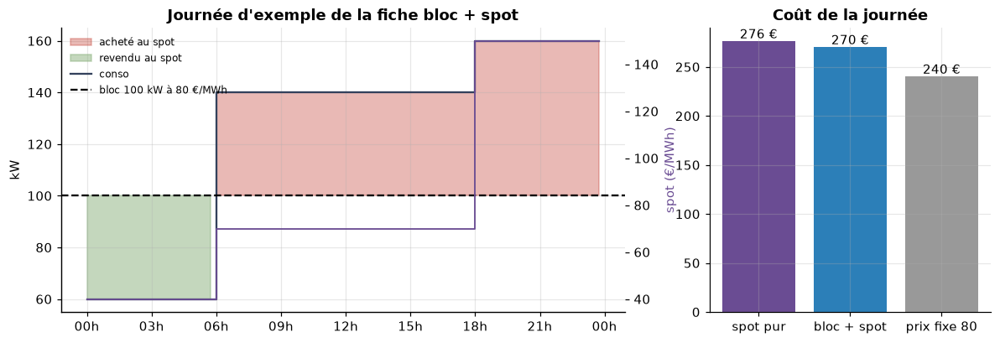

> 📊 **Comment lire :** Exemple de la fiche « bloc + spot ». Le client achète d'avance 100 kW à prix fixe (pointillés). Quand il consomme plus (zone rouge), il achète le reste au prix du marché ; quand il consomme moins (zone verte), il revend l'excédent. La ligne violette est le prix du marché (axe de droite). À droite, le coût de la journée selon trois contrats : on retrouve les 270 € de la fiche.

*(Ligne violette : prix spot, axe de droite.)*

**Interprétation.** Le cas de référence de la fiche est retrouvé **exactement**, par les trois
chemins (fonction, scénario, ligne de commande).

> 📊 **Comment lire :** À gauche, la facture d'énergie de la PME mois par mois selon trois contrats : prix du marché seul (violet), prix fixe à 80 €/MWh (gris), ou mélange des deux (bleu). À droite, le prix moyen du marché chaque mois, comparé au prix fixe de 80. En 2025, le marché a presque toujours été moins cher que le fixe.

| PME, 2025 | Coût annuel de l'énergie |
|---|---|
| Spot pur | **16 860 €** (58,6 €/MWh pondéré par la conso) |
| Bloc 30 kW à 80 €/MWh + spot | 21 834 € |
| Prix fixe 80 €/MWh | 23 019 € |

**Interprétation.**
- En 2025, le spot (61 €/MWh en moyenne) est **sous** le prix fixe de 80 €/MWh que j'ai pris pour
  le bloc : le bloc coûte donc plus cher que le spot pur. C'est l'assurance que l'on paie pour un
  budget sécurisé. Le prix de 80 €/MWh est une hypothèse de la fiche, pas un vrai prix de marché à terme.
- Point utile pour la suite : **le gain d'un équipement est identique en spot pur et en bloc + spot**.
  Le bloc ajoute un terme constant (bloc × (prix bloc − spot)) qui ne dépend pas de la conso. La
  batterie et le PV agissent seulement sur la part au spot.
- Les mois d'été coûtent moins, à cause d'un spot bas en mai–juin.

---

## Étape 3 – PV seul

| Test | Attendu | Obtenu |
|---|---|---|
| `test_conversion_rayonnement_exemples_du_plan` | 1000 J/cm² → 0,14 ; 1700 → 0,24 kW/m² | **0,139 / 0,236** ✅ |
| `test_pv_depuis_facteur_de_charge_et_rayonnement` | P = cf × kWc ; plafond 250 W/m² | ✅ |
| `test_pv_seul_autoconsommation_et_surplus` | 4 kWh autoconsommés, 8 revendus, 20 achetés | ✅ |
| `test_revente_au_prix_de_rachat` | surplus payé 1,1 c€/kWh | ✅ |
| `test_surcout_sur_les_kwh_achetes` | surcoût appliqué aux seuls kWh achetés | ✅ |

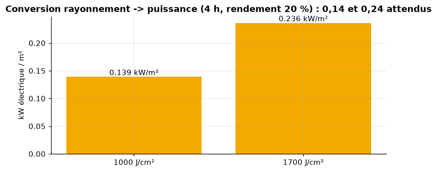

> 📊 **Comment lire :** Vérification d'un calcul du plan : on convertit une quantité de soleil reçue en 4 heures (en J/cm²) en électricité produite par m² de panneau, avec un rendement de 20 %. Les deux barres doivent valoir 0,14 et 0,24 kW/m², ce qui est le cas.

> 📊 **Comment lire :** Un mercredi de juin à la PME, avec 100 kWc de panneaux. La ligne foncée est la consommation ; en orange, l'électricité solaire consommée sur place ; en vert, le surplus revendu ; en pointillés bleus, ce qui est acheté au réseau (sous zéro = revendu). En semaine, presque tout le solaire est consommé sur place.

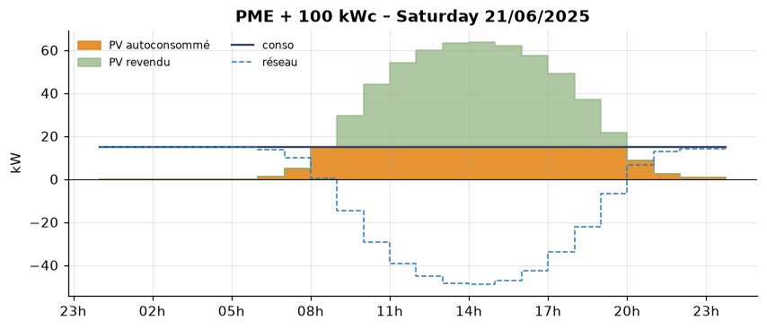

> 📊 **Comment lire :** Même graphique pour un samedi de juin : les bureaux sont fermés, la consommation est faible et presque toute la production solaire part en vert, c'est-à-dire revendue au réseau, souvent à un prix très bas ce jour-là.

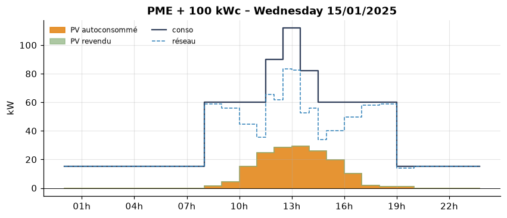

> 📊 **Comment lire :** Même graphique pour un jour de janvier : la production solaire est faible et courte. Elle ne couvre qu'une petite partie de la consommation et il n'y a aucun surplus.

> 📊 **Comment lire :** Ce que deviennent, mois par mois, les kWh produits par les 100 kWc de la PME : consommés directement (orange), stockés en batterie (ici aucun, car il n'y a pas de batterie dans ce cas) ou revendus (vert). La production est 4 fois plus forte en été qu'en hiver.

| PME + 100 kWc (2025) | Valeur |
|---|---|
| Production | 106 947 kWh |
| Autoconsommation (part du PV utilisée sur place) | **87 %** |
| Autoproduction (part de la conso couverte par le PV) | **32 %** |
| Valeur moyenne d'un kWh PV autoconsommé / revendu | **39 €/MWh / 14 €/MWh** (spot moyen 61) |

**Interprétation.**
- En semaine, le PV est presque entièrement absorbé par les bureaux ; **le surplus apparaît le
  week-end** (samedi : quasiment tout est revendu).
- **Effet de cannibalisation :** un kWh solaire vaut en moyenne 39 €/MWh au spot, contre 61 pour un
  kWh moyen, parce que le solaire produit aux heures où le prix est bas. Le surplus revendu ne vaut
  que 14 €/MWh, car il tombe surtout les week-ends ensoleillés à prix négatif ou nul.

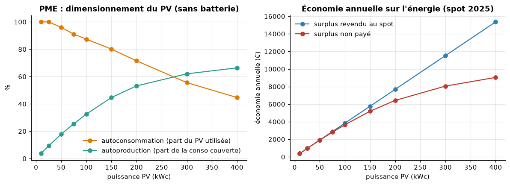

> 📊 **Comment lire :** Que se passe-t-il si on pose plus ou moins de panneaux sur la PME ? À gauche : la part du solaire consommée sur place (orange) baisse quand on en pose beaucoup, tandis que la part de la consommation couverte par le solaire (vert) monte. À droite : l'économie annuelle. Si le surplus est revendu au prix du marché, elle croît en ligne droite ; s'il n'est pas payé (rouge), les grandes installations rapportent beaucoup moins.

**Interprétation.** Au-delà de ~50 kWc, l'autoconsommation baisse : le PV dépasse la conso le midi.
Si le surplus est revendu au spot, le gain est **strictement proportionnel** aux kWc, car un kWh
autoconsommé et un kWh revendu valent alors la même chose. Si le surplus n'est pas payé, la
courbe rouge s'aplatit : 400 kWc rapportent 9 000 € au lieu de 15 400 €. **Le contrat de
revente (et le TURPE évité) décide du bon dimensionnement.**

---

## Étape 4 – Batterie « règle simple » (stocker le surplus PV)

| Test | Attendu | Obtenu |
|---|---|---|
| `test_batterie_un_pas` | E += η·P·Δt ; P bornée à 0,5 C ; pas de décharge sous SOC min | ✅ |
| `test_batterie_surplus_pv_rendement_aller_retour` | 8 kWh chargés → 7,2 kWh restitués (90 %) | ✅ |
| `test_batterie_pleine_le_surplus_est_revendu` | SOC plafonné à 90 %, le reste est revendu | ✅ |
| `check_balance` (appelé à chaque simulation) | bilan P_grid, SOC dans les bornes, énergie conservée | ✅ sur toutes les simulations annuelles |

> 📊 **Comment lire :** Une semaine de juin pour le studio équipé de 3 kWc de panneaux et d'une batterie de 5 kWh. En haut, le niveau de charge de la batterie (en %, de 10 à 90 %). En bas : barres jaunes = la batterie se charge avec le soleil, barres rouges = elle restitue l'énergie le soir ; la ligne violette est le prix du marché. Elle se remplit le jour et se vide le soir, presque chaque jour.

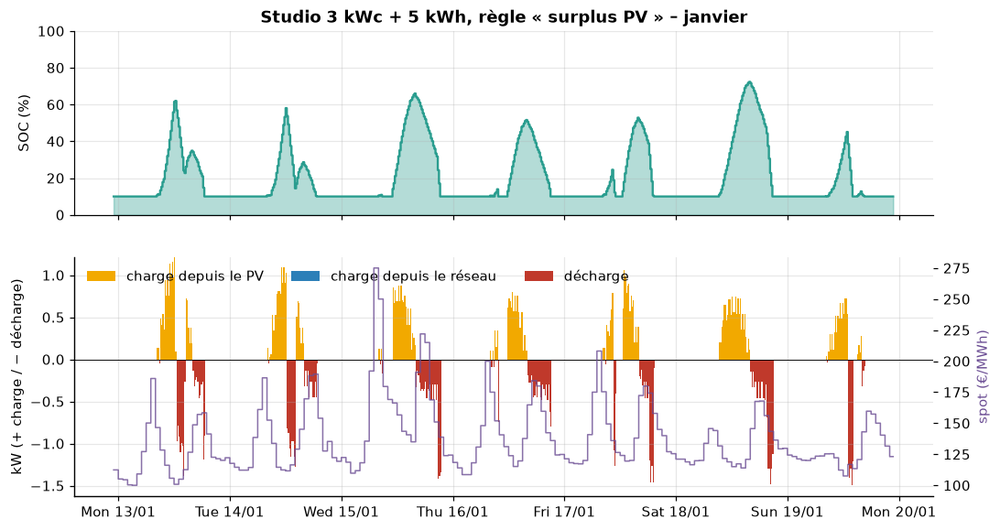

> 📊 **Comment lire :** Même graphique pour une semaine de janvier : le soleil suffit à peine pour la consommation de la journée, la batterie reste presque vide. En hiver, elle sert peu.

> 📊 **Comment lire :** Niveau de charge de la batterie du studio sur toute l'année. Il ne sort jamais des limites fixées (10 % et 90 %, pointillés rouges). C'est un test de bon fonctionnement du modèle de batterie. Elle est surtout utilisée d'avril à septembre.

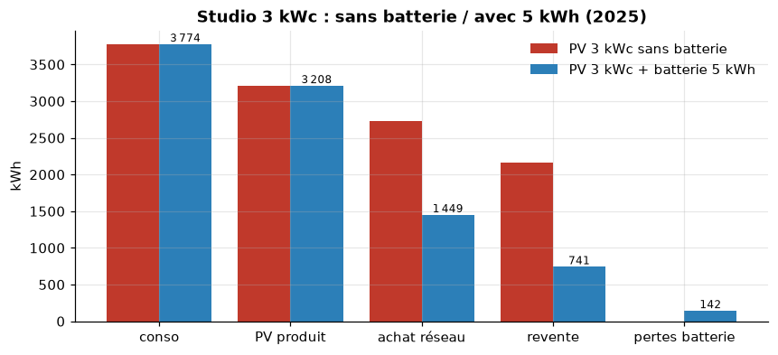

> 📊 **Comment lire :** Bilan d'une année pour le studio avec ses panneaux, sans batterie (rouge) puis avec batterie (bleu), en kWh. La batterie fait passer les achats au réseau d'environ 2 700 à 1 450 kWh et réduit fortement la revente du surplus. Elle perd environ 140 kWh par an (rendement de 90 %).

| Studio, 3 kWc (2025) | Sans batterie | Avec 5 kWh |
|---|---|---|
| Autoconsommation | 33 % | **77 %** |
| Autoproduction | 28 % | **62 %** |
| Achat réseau | 2 728 kWh | 1 449 kWh |
| Cycles / an ; pertes | – | 337 ; 142 kWh |
| Coût énergie (spot, surplus à 1,1 c€) | 191 € | 109 € |

**Interprétation.**
- Le modèle de batterie est **physiquement cohérent** : SOC toujours entre 10 et 90 %, énergie
  conservée à 4·10⁻¹⁴ kWh près sur l'année, pertes de 10 % retrouvées.
- L'été, la batterie se remplit chaque jour et se vide le soir : c'est le cas d'usage idéal.
  L'hiver, elle se remplit à peine : le PV couvre déjà difficilement la conso.
- La batterie **double l'autoconsommation** du studio. En euros, elle ne fait pourtant gagner que
  **83 €/an**, car on ne compte que le prix de l'énergie (~70 €/MWh en moyenne pour le studio).

---

## Étape 5 – Batterie « prix » (prix du lendemain connus)

| Test | Attendu | Obtenu |
|---|---|---|
| `test_strategie_prix_gagne_les_jours_a_fort_spread` | gain 1,349 € > règle simple (0 €) | ✅ |
| `test_strategie_prix_ne_charge_pas_sans_spread` | pas d'achat pour stocker si le spread ne couvre pas les pertes | ✅ |
| `test_strategie_prix_vide_la_batterie_meme_si_la_conso_est_faible` | décharge complète même à 1 kW de conso | ✅ |
| `test_strategie_prix_respecte_la_limite_reseau` | la charge ne dépasse pas la puissance souscrite | ✅ |
| `test_strategie_prix_anticipe_le_surplus_solaire` | si le soleil du jour suffit à remplir la batterie, rien n'est acheté au réseau | ✅ |

**Règle utilisée :** chaque jour, on charge depuis le réseau sur les quarts d'heure les moins chers
et on décharge sur les plus chers, en choisissant juste assez de quarts d'heure pour remplir puis
vider la batterie. On le fait seulement si le spread du jour couvre les pertes. Le surplus PV est toujours stocké.
**La météo du lendemain étant connue** (hypothèse du PowerPoint), on n'achète au réseau que ce que le surplus solaire
attendu ne remplira pas. Cette anticipation, ajoutée après la simulation de Strasbourg, rapporte 6 à 11 % de plus et réduit
d'environ 20 % les achats faits pour remplir la batterie.

> 📊 **Comment lire :** Une semaine de mars à la PME (100 kWc + batterie 100 kWh) pilotée selon les prix. En haut, le niveau de charge de la batterie. En bas : barres bleues = charge depuis le réseau quand le prix (ligne violette) est bas ; barres rouges = décharge quand il est haut ; barres jaunes = charge avec le surplus solaire. La batterie fait environ un « plein puis vidange » par jour.

> 📊 **Comment lire :** Même graphique pour une semaine de juin : la batterie se charge en milieu de journée, quand le prix est au plus bas (souvent proche de zéro grâce au solaire), et se vide le matin et le soir, quand il remonte.

**Interprétation.** La batterie fait environ un cycle par jour : elle se charge **la nuit** ou **au
creux de midi** (prix bas ou négatifs) et se décharge **le matin et le soir**. En juin, la
charge de midi coïncide avec le creux solaire : stocker l'énergie solaire, c'est aussi acheter le kWh le moins cher de la journée.

> 📊 **Comment lire :** Économie annuelle de la PME selon l'équipement installé et la façon de piloter la batterie. Barre bleue = économie sur l'achat d'électricité ; barre verte = économie sur les pénalités payées quand on dépasse la puissance prévue au contrat (négative = on en paie plus). Le total est écrit à droite. Le pilotage selon les prix rapporte le plus sur l'énergie ; le pilotage « écrêter les pointes » (peak shaving) supprime toutes les pénalités.

| PME, économie annuelle vs « rien » | Énergie | Pénalités | Total | Cycles/an |
|---|---|---|---|---|
| PV 100 kWc seul | 3 841 € | 2 179 € | 6 020 € | – |
| PV + batterie, surplus PV | 4 185 € | 2 179 € | 6 364 € | 84 |
| **PV + batterie, prix** | **5 593 €** | 2 179 € | **7 772 €** | 337 |
| PV + batterie, prix **sans limite de puissance** | 5 588 € | **−1 308 €** | 4 280 € | 337 |
| Batterie seule, prix | 1 828 € | 0 € | 1 828 € | 345 |
| Batterie seule, surplus PV | 0 € | 0 € | 0 € | 0 |
| **Batterie seule, peak shaving** | 6 € | **2 640 €** | 2 646 € | 39 |
| PV + batterie, peak shaving | 3 839 € | 2 640 € | 6 479 € | 1 |

> 📊 **Comment lire :** Chaque point est un jour de 2025, pour la PME avec une batterie seule pilotée selon les prix. En abscisse, l'écart entre le prix le plus haut et le plus bas du jour ; en ordonnée, ce que la batterie a fait gagner ce jour-là (couleur = mois). Plus l'écart est grand, plus le gain est élevé ; il dépasse rarement 15 € par jour. Les quelques points sous zéro sont des jours où la règle simple s'est trompée et a perdu un peu d'argent.

**Interprétation.**
- **Validation de l'étape :** sur les jours à fort spread (quart supérieur), la règle « prix »
  rapporte **7,40 €/jour** contre 0 € pour la règle simple (batterie seule) ; le gain croît
  nettement avec le spread. ✅
- Sur une PME qui autoconsomme déjà 87 % de son PV, la règle « surplus PV » n'apporte presque
  rien (+344 €) : il n'y a pas de surplus à stocker en semaine. **C'est l'arbitrage de prix qui fait travailler la batterie.**
- ⚠️ **Découverte :** si on laisse la batterie se charger depuis le réseau sans limite, la pointe passe de 112
  à **136 kW** et les pénalités augmentent (−1 308 €). Il faut toujours brider la charge par la
  puissance souscrite. C'est maintenant le comportement par défaut dès qu'un scénario déclare une puissance souscrite.
- 5 % des jours, la règle perd un peu d'argent : elle ne regarde que les seuils de prix, pas
  **l'ordre** des heures (elle peut décharger le matin à un prix « haut » puis manquer d'énergie pour un soir encore plus cher).
  Une optimisation (étape 9) ferait mieux.
- Première version de la règle (corrigée pendant les tests) : elle visait les 7 quarts d'heure les plus chers en
  supposant une décharge à 50 kW, alors que la PME ne consomme que ~15 kW le soir. La batterie ne
  se vidait jamais. La correction a fait passer le gain de 1 207 à **1 828 €/an** (+51 %).

---

## Étape 6 – Peak shaving

| Test | Attendu | Obtenu |
|---|---|---|
| `test_peak_shaving_ecrete_les_pointes` | pointe 30 → 20 kW ; recharge sous 18 kW ; pénalité 100 € → 0 € | ✅ |

> 📊 **Comment lire :** Les 8 760 heures de l'année, classées de la plus forte à la plus faible puissance achetée au réseau. Le pointillé est la puissance prévue au contrat (90 kW) ; tout ce qui dépasse est pénalisé. Rouge : sans équipement, la PME dépasse quelques centaines d'heures par an. Bleu : la batterie écrête exactement à 90 kW. Vert : une batterie chargée sans limite crée une pointe encore plus haute (136 kW).

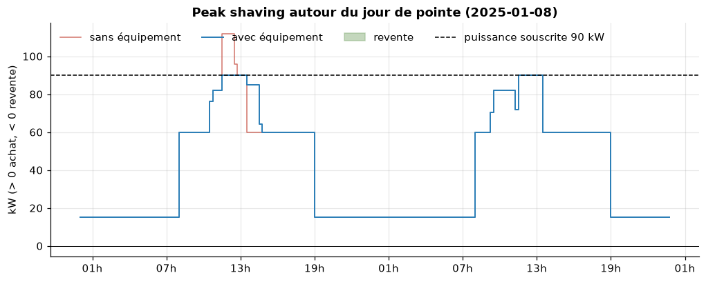

> 📊 **Comment lire :** Les deux jours où la PME consomme le plus. Rouge : puissance achetée sans équipement ; bleu : avec une batterie qui écrête les pointes ; pointillés : puissance prévue au contrat (90 kW). La courbe bleue ne dépasse jamais le pointillé : la batterie fournit le complément pendant les pics de midi et se recharge ensuite, quand la consommation baisse.

> 📊 **Comment lire :** Même période, vue depuis la batterie : en haut son niveau de charge, en bas ses charges (bleu) et décharges (rouge). Elle ne se décharge que pendant les pics, puis se recharge doucement. Elle travaille peu, ce qui ménage son usure.

**Interprétation.**
- La pointe annuelle passe de **112 à 90 kW**, exactement la puissance souscrite, et la pénalité de
  2 640 € à **0 €**. La batterie ne fait que 39 cycles par an : elle s'use très peu.
- La monotone montre que la PME ne dépasse 90 kW que **~500 h/an** (cantine + recharge des véhicules) :
  des pointes courtes, idéales pour une batterie.
- ⚠️ **La pénalité de 10 €/kW/mois est inventée** et la règle de calcul (dépassement maximal du mois) est
  simplifiée. Comme le gain du peak shaving en dépend entièrement, il faut une vraie grille tarifaire avant de conclure.

---

## Étape 7 – Rentabilité

| Test | Attendu | Obtenu |
|---|---|---|
| `test_capex_et_cout_usure` | fiche 5 : 100 kWh, 40 000 €, 5 000 cycles, 80 % → 0,10 €/kWh | ✅ |
| `test_temps_de_retour` | CAPEX 9 500 €, gain 950 €/an → 10 ans ; vie plafonnée à 15 ans | ✅ |

**Hypothèses :** prix unitaires de la fiche 2 (bas / médian / haut), durée de vie de la batterie = min(5 000
cycles, 15 ans), PV 25 ans, OPEX du PV 1,5 %/an, sans actualisation ni dégradation, année 2025 répétée.

> 📊 **Comment lire :** Nombre d'années nécessaires pour que les économies remboursent l'achat de l'équipement, selon que l'équipement est payé au prix bas (vert), moyen (jaune) ou haut (rouge) des fourchettes du devis. Le trait noir est la durée de vie de l'équipement : si la barre le dépasse, l'équipement meurt avant d'être remboursé. La plupart des barres le dépassent.

| Cas (2025, énergie au spot) | Retour prix bas / médian / haut | Durée de vie | Rentable ? |
|---|---|---|---|
| PME : PV 100 kWc | 12 / 28 / 54 ans | 25 ans | **seulement au prix bas** |
| PME : batterie 100 kWh seule, arbitrage | 16 / 23 / 30 ans | 14,5 ans | **non** |
| PME : batterie 100 kWh seule, peak shaving | 11 / 16 / 21 ans | 15 ans | **limite** (bas : oui) |
| PME : batterie ajoutée au PV, arbitrage | 17 / 24 / 31 ans | 14,8 ans | non |
| Studio : PV 3 kWc | jamais (médian) | 25 ans | non (au spot) |
| Studio : batterie 5 kWh ajoutée | 36 / 58 / 79 ans | 14,8 ans | non (au spot) |

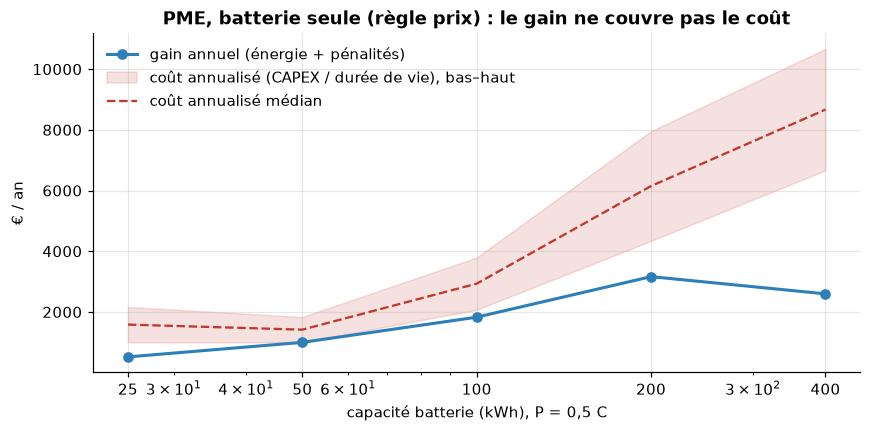

> 📊 **Comment lire :** Pour la PME, batterie seule pilotée selon les prix, de 25 à 400 kWh. Ligne bleue : ce qu'elle fait gagner par an. Zone rouge : ce qu'elle coûte par an (prix d'achat réparti sur sa durée de vie, du moins cher au plus cher). La ligne bleue reste toujours sous la zone rouge : quelle que soit la taille, la batterie coûte plus qu'elle ne rapporte.

> 📊 **Comment lire :** Chaque fois qu'une batterie se charge puis se vide, elle s'use : cela « coûte » environ 75 à 140 € par MWh restitué (traits verticaux, selon son prix d'achat). L'histogramme montre, pour chaque jour de 2025, ce que rapporte un cycle « acheter au plus bas, revendre au plus haut » (pertes comprises). Seuls les jours à droite des traits sont rentables, soit environ un quart des jours.

**Interprétation.**
- **Arbitrage seul : non rentable en 2025.** Le coût d'usure d'un kWh déchargé (CAPEX ÷ kWh
  restituables sur la vie) vaut **106 €/MWh** au prix médian, alors que le spread journalier × 90 % ne le
  dépasse que **24 % des jours**. Quelle que soit la taille, le gain annuel reste sous le coût annualisé.
- Au-delà de 200 kWh, le gain **baisse** (400 kWh rapportent moins que 200 kWh) : la règle charge
  sur trop de quarts d'heure pas assez bon marché, sous la contrainte de puissance souscrite. Une
  batterie plus grande ne peut pas faire moins bien avec un pilotage optimal : c'est une **limite de la règle simple**.
- **Ce qui peut rendre la batterie rentable : les pénalités de puissance**, avec peu de cycles et un fort
  gain par kWh, mais elles reposent ici sur une hypothèse inventée.

> 📊 **Comment lire :** Sur une vraie facture, chaque kWh acheté coûte aussi des frais de réseau et des taxes, ignorés par défaut dans ce rapport. En abscisse, le montant de ces frais par MWh. À gauche, le gain annuel ; à droite, le nombre d'années pour rembourser (sous les traits noirs = rentable). Plus ces frais sont élevés, plus les panneaux deviennent rentables. Seule la batterie qui spécule sur les prix (vert) y perd, car elle achète plus de kWh qu'elle n'en rend.

**Interprétation de la sensibilité** (surcoût ajouté à chaque kWh acheté : acheminement + taxes) :
- **PV de la PME :** dès 50 €/MWh de surcoût évité, le retour tombe à 18 ans ; à 100 €/MWh, à **10,5 ans**. Le PV
  devient clairement rentable : ce sont ces coûts évités qui font sa valeur, plus que le spot.
- **Batterie du studio, ajoutée au PV :** à 200 €/MWh (ordre de grandeur d'un particulier, à vérifier), retour d'environ **14 ans**,
  soit à peu près sa durée de vie. C'est à la limite.
- **Batterie seule en arbitrage :** son gain **diminue** quand le surcoût augmente. Elle achète
  plus de kWh au réseau qu'elle n'en restitue (pertes de 10 %), et chaque kWh acheté supporte le surcoût. L'arbitrage pur
  est pénalisé par les tarifs de réseau.

---

## Étape 8 – Les 7 graphiques du plan (commande `python -m simu run … --out`)

Générés automatiquement pour la PME (PV 100 kWc + batterie 100 kWh, règle prix) ; même jeu pour le
studio dans [fig/e8_studio](fig/e8_studio). Export CSV de tous les pas : `results/pme/resultats.csv`.

### 1. Utilisation du solaire

> 📊 **Comment lire :** Ce que deviennent chaque mois les kWh produits par les 100 kWc de la PME, maintenant avec batterie : consommés directement (orange), stockés dans la batterie (vert foncé) ou revendus (vert clair). Le titre donne la production totale et la part utilisée sur place.

### 2. Utilisation de la batterie

> 📊 **Comment lire :** Une semaine de juin de la batterie de la PME. En haut, son niveau de charge ; en bas, ses charges depuis le soleil (jaune) ou le réseau (bleu) et ses décharges (rouge), avec le prix du marché (ligne violette, axe de droite).

### 3. Courbe de charge brute

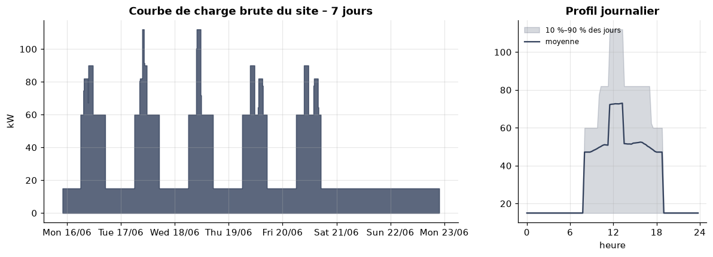

> 📊 **Comment lire :** Consommation de la PME, avant tout équipement. À gauche, une semaine de juin ; à droite, la journée moyenne de l'année (ligne) et la plage dans laquelle se trouvent 80 % des jours (bande grise).

### 4. Ce qu'on achète au réseau

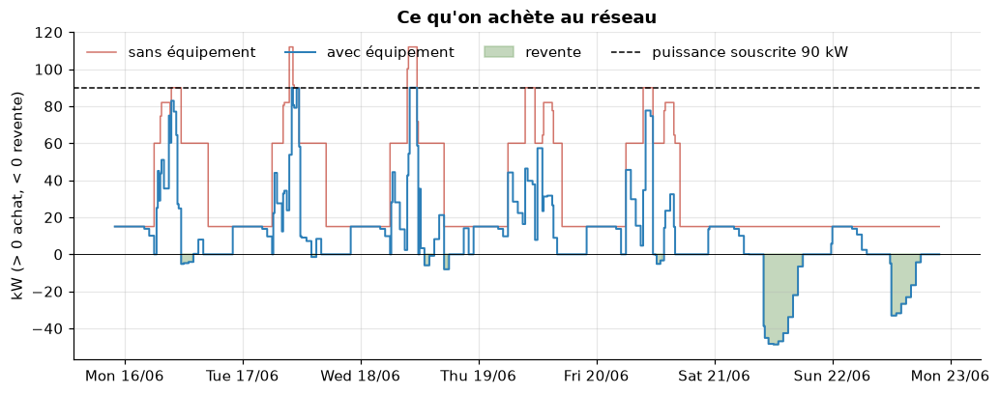

> 📊 **Comment lire :** Ce que la PME achète au réseau pendant une semaine de juin, sans équipement (rouge) et avec panneaux et batterie (bleu). Sous zéro (zone verte), elle revend. Le pointillé est la puissance prévue au contrat. Avec l'équipement, les achats de la journée sont fortement réduits et ne dépassent plus le pointillé, et le week-end la PME revend.

### 5. Coût de l'énergie

> 📊 **Comment lire :** Facture d'électricité de la PME, mois par mois, sans équipement (rouge) et avec panneaux et batterie (bleu). Le titre donne l'économie sur l'année et la légende les totaux annuels. Seul le prix de l'énergie est compté, sans frais de réseau ni taxes.

### 6. Coût de la batterie

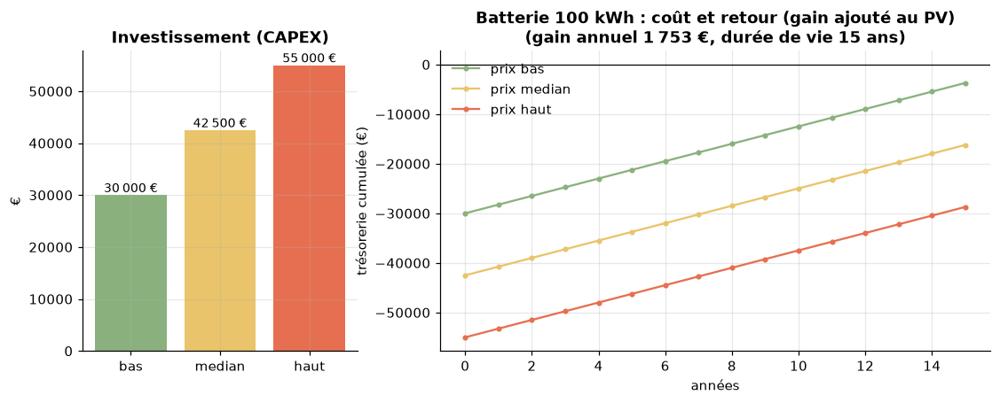

> 📊 **Comment lire :** La batterie de 100 kWh seule. À gauche, son prix d'achat selon trois devis (bas, moyen, haut). À droite, l'argent cumulé au fil des années : on part du prix d'achat (négatif) et on ajoute chaque année ce qu'elle fait gagner en plus des panneaux. Si la ligne croise zéro avant la fin (15 ans), la batterie est remboursée ; ici, jamais.

### 7. Coût des panneaux

> 📊 **Comment lire :** Même lecture pour les 100 kWc de panneaux, sur 25 ans. La ligne verte (prix d'achat bas) croise zéro au bout d'environ 12 ans : remboursé, puis bénéficiaire. Au prix moyen et au prix haut, les panneaux ne sont pas remboursés en 25 ans, si l'on ne compte que le prix de l'énergie.

**Interprétation.** L'économie mensuelle est assez régulière en euros (≈ 300 à 700 €/mois). L'hiver,
c'est surtout la batterie qui arbitre des prix élevés ; l'été, c'est le PV. En proportion, elle est
bien plus forte l'été (juillet : −55 %) que l'hiver (janvier : −20 %). Les graphiques 6 et 7 séparent bien les deux investissements. La batterie,
évaluée **en plus** du PV, ne rentre pas dans ses frais sur 15 ans, même au prix bas.
Le PV (gain de 6 020 €/an, pénalités évitées comprises) n'est rentable qu'au prix bas (retour
en 12 ans) ; au prix médian il finit à −14 500 € au bout de 25 ans (toujours sans acheminement ni taxes évités).

---

## Simulation Strasbourg / Grand Est (demandée au point du 23/11, slides 5 et 6)

C'est la simulation décrite dans le PowerPoint : **conso bottom-up (avec chauffage selon la température
réelle) + panneaux calculés d'après le rayonnement solaire réel + batterie + achat/vente au prix du marché**,
pour un client situé à **Strasbourg**, sur toute l'année 2025.

| Donnée | Source (API, sans clé) |
|---|---|
| Rayonnement solaire global, Grand Est, toutes les 3 h | RTE / ODRÉ : `rayonnement-solaire-vitesse-vent-tri-horaires-regionaux` |
| Température moyenne quotidienne, Grand Est | RTE / ODRÉ : `temperature-quotidienne-regionale` |
| Production solaire réelle du Grand Est (pour valider) | RTE éCO2mix régional : `eco2mix-regional-cons-def` + parc régional |
| Prix spot France (Strasbourg est dans la zone de prix France) | Energy-Charts : `price?bzn=FR` |

Lancer : `python -m simu run scenarios/studio_strasbourg.yaml --out results/studio_strasbourg`
(idem avec `pme_strasbourg.yaml`).

### Tests ajoutés

| Test | Ce qu'il vérifie | Résultat |
|---|---|---|
| `test_hauteur_du_soleil_strasbourg` | hauteur du soleil à midi le 21/06 (≈ 65°) et le 21/12 (≈ 18°), nuit < 0 | ✅ |
| `test_repartition_conserve_l_energie_du_jour` | les blocs de 3 h passés au 1/4 h gardent exactement l'énergie du jour | ✅ |
| `test_repartition_nulle_la_nuit_et_sans_marche` | rayonnement nul la nuit, pas de marche entre deux blocs, montée régulière le matin | ✅ |
| `test_lecture_rayonnement_et_format_standard` | lecture de l'API → format standard, maximum vers midi | ✅ |
| `test_temperature_jour_absent_interpole` | un jour absent du jeu (ex. 31/01) est interpolé et signalé | ✅ |
| `test_pv_par_rayonnement_chaine_du_plan` | 100 kWc = 400 m² ; 1000 W/m² × 20 % × 400 m² = 80 kW ; exemple 1000 J/cm² | ✅ |

### Du rayonnement à la production des panneaux

> 📊 **Comment lire :** La donnée publiée (zones jaunes) est une moyenne du soleil reçu toutes les 3 heures,
> trop grossière pour une simulation au quart d'heure. La courbe orange est ce que le simulateur en fait :
> la même énergie, répartie selon la hauteur du soleil à Strasbourg (nulle la nuit, maximale à midi).
> À gauche, une journée d'été ensoleillée ; à droite, une journée d'hiver.

**Méthode (chaîne du PowerPoint, slide 6) :** rayonnement (W/m²) × rendement 20 % × surface, avec
surface = kWc ÷ Pmax 250 W/m² (100 kWc = 400 m²), plafonné à 250 W/m². Rayonnement sur une surface
**horizontale** : inclinaison et orientation des panneaux ne sont pas modélisées.

**Points vérifiés sur les données :**
- La valeur horodatée T est la **moyenne sur les 3 heures précédentes**, en UTC. C'est la convention du
  modèle météo du CEPMMT (ECMWF), confirmée par la corrélation avec la production réelle, identique l'été et l'hiver.
- La source attribue quelques W/m² à des blocs de nuit, signe d'un décalage d'environ 30 min. La méthode les
  reporte sur les heures de jour du même jour, sans perdre d'énergie.

> 📊 **Comment lire :** À gauche, l'énergie produite chaque mois par 1 kWc de panneaux : calculée par le
> simulateur à partir du rayonnement (orange), mesurée par RTE sur l'ensemble des installations du Grand Est
> (vert) et sur toute la France (gris). À droite, une semaine de juin quart d'heure par quart d'heure :
> le modèle (orange) suit bien la production réelle (vert) jour après jour, nuages compris.

| 2025 | Modèle (rayonnement) | Réel Grand Est (RTE) | Réel France |
|---|---|---|---|
| Production annuelle par kWc | **1 076 kWh** | **1 068 kWh** | 1 069 kWh |
| Corrélation au 1/4 h avec le réel Grand Est | 0,93 | – | 0,94 |

**Interprétation.**
- **Sur l'année, le modèle tombe juste à 1 % près.** La chaîne du PowerPoint, avec Pmax 250 W/m² et un rendement de 20 %, est donc
  réaliste sans autre correction. Le fait que le facteur 0,2 × 4 m²/kWc = 0,8 corresponde aux pertes réelles est sans doute en partie
  une coïncidence, mais le résultat est là.
- **Par mois, il y a un biais saisonnier** : le modèle surestime le printemps et l'été (mai : +23 %) et sous-estime
  l'automne (octobre : −22 %). C'est cohérent avec un rayonnement **horizontal** : les vrais panneaux sont inclinés
  et captent mieux le soleil bas d'automne. Une correction d'inclinaison serait la prochaine amélioration.
- Au quart d'heure, le profil national réel colle un peu mieux (0,94) que le modèle (0,93) : le rayonnement
  est une moyenne régionale de modèle météo, publiée toutes les 3 h.
- ⚠️ **Anomalie dans la source RTE :** le **30/06/2025**, éCO2mix régional publie jusqu'à **3 824 MW** de solaire
  dans le Grand Est, pour un parc de **2 602 MW**. C'est impossible ; ce jour est exclu des corrélations.
- Les températures ODRÉ n'ont **pas de valeur pour le dernier jour de chaque mois** (31/01, 28/02…) : ces
  12 jours sont interpolés, et un avertissement le signale.

### Chauffage d'après la température réelle

> 📊 **Comment lire :** La ligne bleue est la température moyenne de chaque jour de 2025 dans le Grand Est
> (axe de droite) ; le pointillé marque 15 °C. Les barres rouges sont la consommation de chauffage du studio
> chaque jour (axe de gauche). Elles n'existent que les jours sous 15 °C et grandissent quand il fait froid :
> c'est la formule du PowerPoint, E = k × (20 °C − température).

| 2025, Grand Est | Valeur |
|---|---|
| Température moyenne quotidienne | de −2,8 °C à 28,6 °C |
| Jours sous 15 °C (chauffage) | 237 |
| Σ (20 − T) sur ces jours | 2 900 °C·jour |
| Chauffage du studio avec k = 0,5 kWh/°C/jour | **1 450 kWh/an** |

⚠️ **k = 0,5 est inventé** (le PowerPoint ne donne pas de valeur). Avec le chauffage, le studio consomme
**5 224 kWh/an (14,3 kWh/jour)**, au-dessus des 4 300 kWh/an du PowerPoint. Soit le chauffage du studio de
référence n'est pas électrique, soit les autres appareils sont surestimés (frigo à 2,24 kWh/jour, machines tous les jours).

> 📊 **Comment lire :** La consommation du studio pendant une semaine de janvier, appareil par appareil
> (couleurs empilées). Le chauffage forme un socle permanent, plus épais les jours froids, auquel s'ajoutent
> les pics des machines et de l'éclairage. À droite, la journée moyenne de cette semaine.

### Résultats

| 2025, Strasbourg | Studio (3 kWc + 5 kWh) | PME de bureaux (100 kWc + 100 kWh) |
|---|---|---|
| Consommation | 5 224 kWh (dont 1 450 de chauffage) | 287 739 kWh |
| Production PV | 3 229 kWh | 107 621 kWh |
| Autoconsommation / autoproduction | 72 % / 42 % | 90 % / 33 % |
| Cycles de batterie par an | 360 | 340 |
| Coût de l'énergie au spot, sans → avec équipement | 379 € → 200 € | 16 860 € → 11 578 € |
| Pénalités de dépassement, sans → avec | – | 2 640 € → 674 € |
| Gain annuel dû au PV | 87 € | 5 503 € (dont pénalités évitées) |
| Gain annuel dû à la batterie (en plus du PV) | 92 € | 1 744 € |
| Retour du PV, prix bas / médian / haut (durée de vie 25 ans) | 139 ans / 509 ans / jamais | **13** / 32 / 64 ans |
| Retour de la batterie, prix bas / médian / haut (durée de vie ≈ 14 ans) | 33 / 52 / 71 ans | 17 / 24 / 32 ans |

**Interprétation.**
- **Les conclusions sont les mêmes qu'avec le profil national** : en 2025, Strasbourg a produit autant
  par kWc que la moyenne française. Si l'on ne compte que le prix de l'énergie au spot, **le PV de la PME est
  rentable seulement au prix bas** (13 ans) et **la batterie ne l'est dans aucun cas**.
- **Pour le studio, rien n'est rentable au prix spot** : l'électricité y coûte en moyenne ~72 €/MWh, et un
  particulier paie en réalité bien plus (acheminement + taxes). C'est exactement la limite expliquée en § 7 : avec
  ces coûts, la sensibilité montre un retour d'environ 14 ans pour la batterie du studio à 200 €/MWh de surcoût évité.
- Le chauffage d'hiver rend la batterie utile **même sans soleil** : elle se charge la nuit, quand le prix est plus bas, et
  restitue au pic du soir (graphique ci-dessous).

> 📊 **Comment lire :** La batterie du studio pendant une semaine de janvier. En haut, son niveau de charge ;
> en bas, ses charges depuis le réseau (bleu) ou le soleil (jaune, très faibles en hiver) et ses décharges (rouge),
> avec le prix du marché (ligne violette). Elle se remplit chaque nuit quand le prix est bas et se vide le soir
> quand il est haut : en hiver, c'est le prix et non le soleil qui la fait travailler.

### Les 7 graphiques du PowerPoint – studio de Strasbourg

#### 1. Utilisation du solaire

> 📊 **Comment lire :** Ce que deviennent chaque mois les kWh produits par les 3 kWc du studio : consommés
> directement (orange), stockés dans la batterie (vert foncé) ou revendus (vert clair). L'été, une grande partie est
> revendue car le studio consomme peu en journée.

#### 2. Utilisation de la batterie

> 📊 **Comment lire :** Une semaine de juin. En haut, le niveau de charge de la batterie ; en bas, ses charges
> (jaune = soleil, bleu = réseau) et décharges (rouge), avec le prix du marché (violet). L'été, elle se remplit
> surtout avec le soleil de midi et se vide le soir.

#### 3. Courbe de charge brute

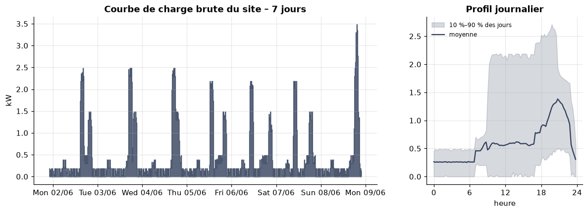

> 📊 **Comment lire :** La consommation du studio, sans équipement, pendant une semaine de juin (à gauche) et
> la journée moyenne de l'année (à droite, avec la plage où se trouvent 80 % des jours). En été, il n'y a pas de chauffage.

#### 4. Ce qu'on achète au réseau

> 📊 **Comment lire :** La puissance achetée au réseau pendant une semaine de juin, sans équipement (rouge) et
> avec panneaux + batterie (bleu). Sous zéro (vert), le studio revend son surplus solaire. Avec l'équipement, les
> achats du soir diminuent fortement (la batterie, remplie par le soleil, les couvre). Les pics bleus restants
> sont des soirées où la batterie de 5 kWh est déjà vide quand le lave-vaisselle démarre. En juin, elle ne se
> recharge pas au réseau la nuit : le soleil du lendemain suffit.

#### 5. Coût de l'énergie

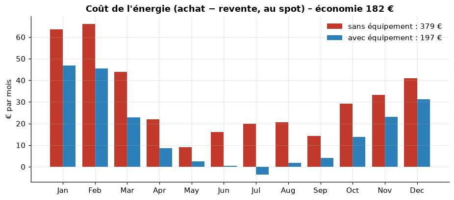

> 📊 **Comment lire :** La facture d'énergie du studio mois par mois, sans (rouge) et avec équipement (bleu).
> L'hiver coûte le plus cher à cause du chauffage et des prix élevés. Seul le prix de l'énergie est compté,
> sans acheminement ni taxes. Dans ce graphique, le surplus revendu est compté au prix du marché ; dans le
> tableau ci-dessus, au tarif de rachat de 1,1 c€/kWh, d'où un léger écart.

#### 6. Coût de la batterie

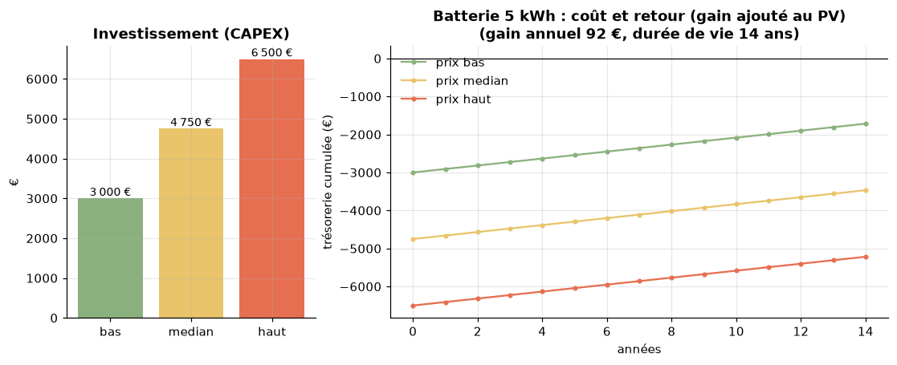

> 📊 **Comment lire :** À gauche, le prix de la batterie de 5 kWh selon trois devis. À droite, l'argent cumulé
> au fil des ans : on part du prix payé et on ajoute chaque année ce que la batterie fait gagner. Si la ligne
> ne repasse pas au-dessus de zéro avant la fin, la batterie n'est pas remboursée ; c'est le cas ici.

#### 7. Coût des panneaux

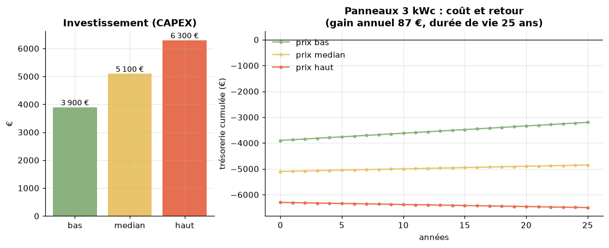

> 📊 **Comment lire :** Même lecture pour les 3 kWc de panneaux sur 25 ans. Au prix spot seul, le gain
> (≈ 87 €/an) couvre à peine l'entretien : les lignes restent très en dessous de zéro.

### Les 7 graphiques du PowerPoint – PME de Strasbourg

#### 1. Utilisation du solaire

> 📊 **Comment lire :** Ce que deviennent chaque mois les kWh produits par les 100 kWc de la PME :
> consommés directement (orange), stockés (vert foncé) ou revendus (vert clair). Presque tout est consommé
> sur place, car les bureaux consomment en journée.

#### 2. Utilisation de la batterie

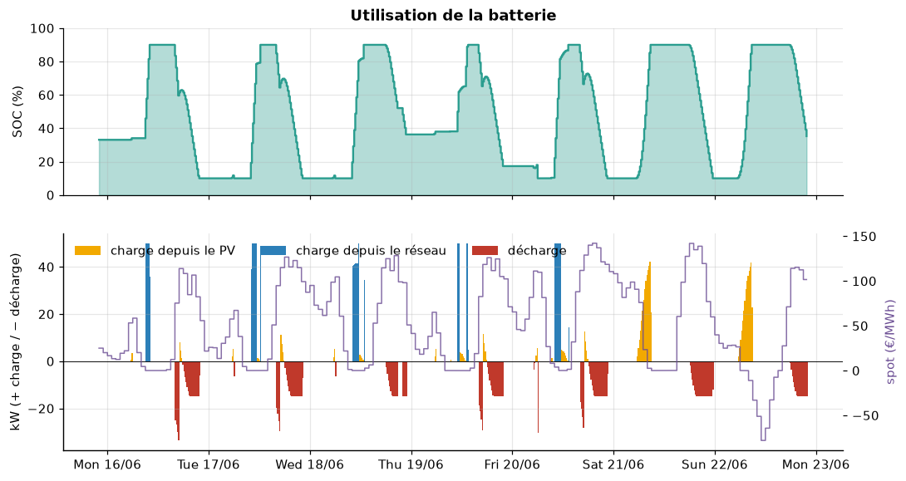

> 📊 **Comment lire :** Une semaine de juin. En haut, le niveau de charge de la batterie de 100 kWh ; en bas,
> ses charges (jaune = soleil, bleu = réseau) et décharges (rouge), avec le prix du marché (violet). Elle fait
> environ un cycle par jour, en achetant aux heures creuses et en restituant aux heures chères.

#### 3. Courbe de charge brute

> 📊 **Comment lire :** La consommation de la PME sans équipement : une semaine de juin à gauche (journées de
> bureau, pics de cantine, week-end au minimum) et la journée moyenne de l'année à droite.

#### 4. Ce qu'on achète au réseau

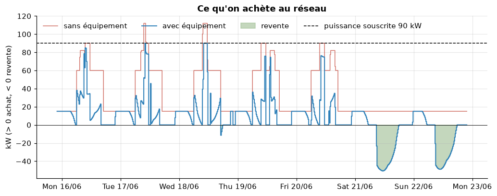

> 📊 **Comment lire :** La puissance achetée au réseau sur une semaine de juin, sans équipement (rouge) et avec
> panneaux + batterie (bleu) ; sous zéro (vert), la PME revend. Le pointillé est la puissance prévue au contrat
> (90 kW) : la dépasser coûte une pénalité.

#### 5. Coût de l'énergie

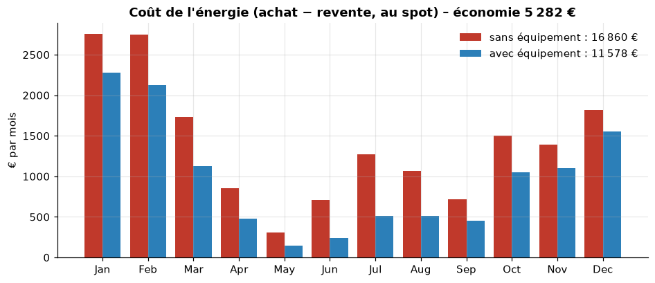

> 📊 **Comment lire :** La facture d'énergie de la PME mois par mois, sans (rouge) et avec équipement (bleu).
> Le titre donne l'économie annuelle sur l'énergie, hors pénalités, acheminement et taxes.

#### 6. Coût de la batterie

> 📊 **Comment lire :** À gauche, le prix de la batterie de 100 kWh selon trois devis ; à droite, l'argent
> cumulé au fil des ans, en partant du prix payé et en ajoutant le gain apporté par la batterie en plus des panneaux.
> Aucune ligne ne repasse au-dessus de zéro en ≈ 15 ans : la batterie n'est pas remboursée.

#### 7. Coût des panneaux

> 📊 **Comment lire :** Même lecture pour les 100 kWc de panneaux, sur 25 ans. La ligne verte (prix bas)
> passe au-dessus de zéro vers 13 ans : les panneaux sont alors remboursés. Aux prix moyen et haut, ils ne le
> sont pas en 25 ans si l'on ne compte que le prix de l'énergie.

---

## Limites connues (à garder en tête en lisant les chiffres)

1. **Clients inventés** (studio, PME) et **pénalité de dépassement inventée** (10 €/kW/mois).
2. **Pas d'acheminement ni de taxes** dans le coût par défaut : gains de l'autoconsommation sous-estimés (§ 7).
3. Une seule année (2025), répétée sur toute la durée de vie : pas d'actualisation, pas d'inflation, pas de dégradation.
4. PV : profil national, ou rayonnement **régional** (Grand Est) sur surface horizontale : ni inclinaison ni orientation des panneaux.
5. Règles de pilotage simples, non optimales (chronologie des prix ignorée ; batterie > 200 kWh mal exploitée).
6. Coût unitaire pris dans la classe de taille la plus proche (10 / 100 / 1000) : marches d'escalier entre les tailles.
7. Écart de prix du PV : le médian de la fiche pour 100 kWc (120 k€) est au-dessus du « coût moyen 80–100 k€ en toiture simple » cité dans la même fiche.

## Décisions et informations attendues

- **Frigo :** 1 kWh/jour ou paramètres 400 W / 7 min / 2×/h (= 2,24 kWh) ?
- **Composition du studio** et fréquence des machines.
- **Grille de pénalités de dépassement** réelle (TURPE / contrat) et puissance souscrite type.
- **Surcoût par kWh acheté** (acheminement + taxes) à retenir par type de client.
- **Prix de revente** du surplus pour un client pro (spot via agrégateur ? obligation d'achat ?).
- Valider l'ajout de `import_surcharge_eur_mwh`, `export_price_eur_mwh`, `grid` et `strategy` au format YAML.
